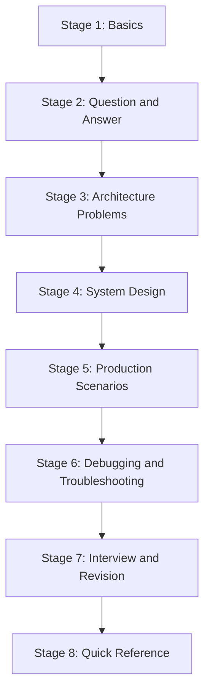

# Learning Roadmap

This roadmap describes the intended order for studying Azure Function App. Each stage builds on the previous one.

## Stage 1 — Basics

**Goal:** Understand what a function app is, how it is hosted and how it is triggered.

- [ ] [Azure Functions Overview](docs/Azure/Azure-Function-App/01-Basics/Azure-Functions-Overview.md)
- [ ] [Hosting Plans](docs/Azure/Azure-Function-App/01-Basics/Hosting-Plans.md)
- [ ] [Triggers and Bindings](docs/Azure/Azure-Function-App/01-Basics/Triggers-and-Bindings.md)
- [ ] [In-Process vs Isolated Worker](docs/Azure/Azure-Function-App/01-Basics/In-Process-vs-Isolated-Worker.md)
- [ ] [Project Structure](docs/Azure/Azure-Function-App/01-Basics/Project-Structure.md)
- [ ] [Configuration and Environment](docs/Azure/Azure-Function-App/01-Basics/Configuration-and-Environment.md)
- [ ] [Local vs Azure Execution](docs/Azure/Azure-Function-App/01-Basics/Local-vs-Azure-Execution.md)

## Stage 2 — Question and Answer

**Goal:** Answer common practical questions precisely.

- [ ] [DefaultAzureCredential: Local vs Azure](docs/Azure/Azure-Function-App/02-Question-Answer/DefaultAzureCredential-Local-vs-Azure.md)
- [ ] [Rate Limiter vs Load Balancer](docs/Azure/Azure-Function-App/02-Question-Answer/Rate-Limiter-vs-Load-Balancer.md)
- [ ] [Dependency Injection in Isolated Worker](docs/Azure/Azure-Function-App/02-Question-Answer/Dependency-Injection-in-Isolated-Worker.md)
- [ ] [CORS vs API Management](docs/Azure/Azure-Function-App/02-Question-Answer/CORS-vs-API-Management.md)
- [ ] [Managed Identity Connection Management](docs/Azure/Azure-Function-App/02-Question-Answer/Managed-Identity-Connection-Management.md)
- [ ] [Function Scaling Questions](docs/Azure/Azure-Function-App/02-Question-Answer/Function-Scaling-Questions.md)

## Stage 3 — Architecture Problems

**Goal:** Combine concepts to solve constraint-driven problems.

- [ ] [AP-001 Downstream API Throttling](docs/Azure/Azure-Function-App/03-Architecture-Problems/AP-001-Downstream-API-Throttling.md)
- [ ] [AP-002 Duplicate Message Processing](docs/Azure/Azure-Function-App/03-Architecture-Problems/AP-002-Duplicate-Message-Processing.md)
- [ ] [AP-003 Long-Running Operation](docs/Azure/Azure-Function-App/03-Architecture-Problems/AP-003-Long-Running-Operation.md)
- [ ] [AP-004 High-Traffic HTTP Function](docs/Azure/Azure-Function-App/03-Architecture-Problems/AP-004-High-Traffic-HTTP-Function.md)
- [ ] [AP-005 Secure Secretless Architecture](docs/Azure/Azure-Function-App/03-Architecture-Problems/AP-005-Secure-Secretless-Architecture.md)

## Stage 4 — System Design

**Goal:** Design complete systems and defend the trade-offs.

- [ ] [SD-001 Order Processing System](docs/Azure/Azure-Function-App/04-System-Design/SD-001-Order-Processing-System.md)
- [ ] [SD-002 Payment Processing System](docs/Azure/Azure-Function-App/04-System-Design/SD-002-Payment-Processing-System.md)
- [ ] [SD-003 Notification System](docs/Azure/Azure-Function-App/04-System-Design/SD-003-Notification-System.md)
- [ ] [SD-004 File Processing Pipeline](docs/Azure/Azure-Function-App/04-System-Design/SD-004-File-Processing-Pipeline.md)
- [ ] [SD-005 High-Volume Event Processing](docs/Azure/Azure-Function-App/04-System-Design/SD-005-High-Volume-Event-Processing.md)

## Stage 5 — Production Scenarios

**Goal:** Diagnose real symptoms methodically.

- [ ] [PS-001 Works Locally, Fails in Azure](docs/Azure/Azure-Function-App/05-Production-Scenarios/PS-001-Works-Locally-Fails-in-Azure.md)
- [ ] [PS-002 Intermittent Timeouts](docs/Azure/Azure-Function-App/05-Production-Scenarios/PS-002-Intermittent-Timeouts.md)
- [ ] [PS-003 Sudden Traffic Spike](docs/Azure/Azure-Function-App/05-Production-Scenarios/PS-003-Sudden-Traffic-Spike.md)
- [ ] [PS-004 Service Bus Message Failures](docs/Azure/Azure-Function-App/05-Production-Scenarios/PS-004-Service-Bus-Message-Failures.md)
- [ ] [PS-005 Authentication Failure](docs/Azure/Azure-Function-App/05-Production-Scenarios/PS-005-Authentication-Failure.md)

## Stage 6 — Debugging and Troubleshooting

- [ ] [Troubleshooting Checklist](docs/Azure/Azure-Function-App/06-Debugging-Troubleshooting/Troubleshooting-Checklist.md)
- [ ] Remaining checklists in the [Debugging index](docs/Azure/Azure-Function-App/06-Debugging-Troubleshooting/index.md)

## Stage 7 — Interview and Revision

- [ ] [Advanced Architecture Questions](docs/Azure/Azure-Function-App/07-Interview-Revision/Advanced-Architecture-Questions.md)
- [ ] [Rapid Revision](docs/Azure/Azure-Function-App/07-Interview-Revision/Rapid-Revision.md)

## Stage 8 — Quick Reference

- [ ] [Decision Matrix](docs/Azure/Azure-Function-App/08-Quick-Reference/Decision-Matrix.md)
- [ ] Remaining references in the [Quick Reference index](docs/Azure/Azure-Function-App/08-Quick-Reference/index.md)

> 📌 Tick items as you complete them. Revisit Stage 7 before interviews.
