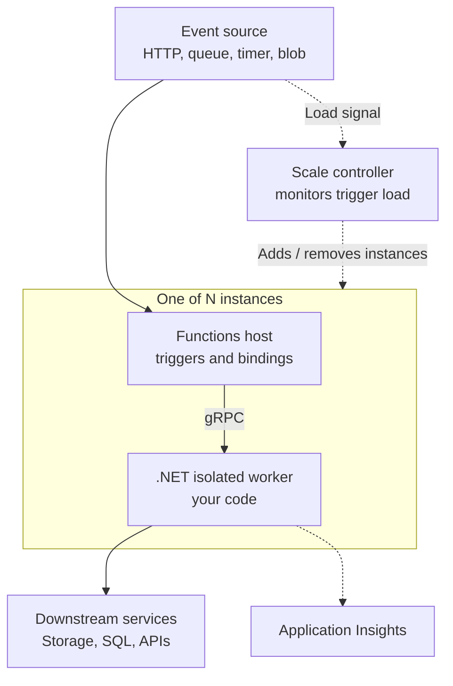

# Azure Functions Overview

> **Category:** Basics · **Status:** Complete sample note · **Applies to:** Azure Functions runtime 4.x, .NET isolated worker

This note explains what Azure Functions is, why teams use it, how it runs your code and where it does not fit. Read it before the other Basics notes.

---

## What it is

**Azure Functions** is a serverless compute service. You write small units of code called **functions**, and Azure runs them when an **event** occurs.

- A **function** is a single method with a **trigger** (the event that starts it).
- A **Function App** is the deployment and management unit. It groups one or more functions that share the same configuration, hosting plan, runtime version and identity.
- **Serverless** here means you do not manage servers or virtual machines. You still choose a **hosting plan**, which decides how instances are allocated and billed.

> 💡 The Function App — not the individual function — is what you deploy, scale, configure and secure. All functions in an app share app settings, the managed identity and (on most plans) the same instances.

## Why it is used

| Need | How Azure Functions helps |
| --- | --- |
| React to events | Built-in triggers for HTTP, queues, timers, blobs, Event Grid, Event Hubs, Cosmos DB and more. |
| Scale with load | The platform adds and removes instances based on trigger activity (behaviour depends on hosting plan). |
| Reduce boilerplate | **Bindings** connect to other services declaratively, so you write less SDK plumbing. |
| Pay for usage | Consumption-style plans bill for executions and resources used, not idle servers. |
| Ship small units | Each function is small and focused, which suits background jobs and integration glue. |

**Typical workloads:**

- HTTP APIs and webhooks with variable traffic
- Processing messages from Service Bus or Storage queues
- Scheduled jobs (timer trigger)
- Reacting to file uploads or database changes
- Lightweight integration between SaaS systems

## How it works



Step by step:

1. **An event arrives.** For example, an HTTP request or a new Service Bus message.
2. **The scale controller** watches trigger sources (such as queue length) and decides how many instances to run. Exact scaling rules depend on the hosting plan and trigger type.
3. **The Functions host** on an instance receives the event through the trigger extension.
4. **The host invokes your function** in the **isolated worker process** (a separate .NET process) over gRPC.
5. **Your code runs**, uses injected services and returns a result. Output bindings, if any, write results to other services.
6. **Telemetry** (requests, dependencies, logs, exceptions) flows to Application Insights when configured.

> ⚠️ Instances are **stateless and disposable**. Do not store important state in memory or on the local disk. An instance can be recycled or removed at any time.

## Important components

| Component | Responsibility |
| --- | --- |
| **Function App** | Deployment unit; holds settings, identity, plan and runtime version. |
| **Function** | A method with one trigger and optional input/output bindings. |
| **Trigger** | Defines what starts the function. Exactly one per function. |
| **Binding** | Declarative input or output connection to another service. Optional. |
| **Functions host** | The runtime that listens to triggers, manages bindings and exposes HTTP endpoints. |
| **Isolated worker** | Separate .NET process that runs your code. See [In-Process vs Isolated Worker](In-Process-vs-Isolated-Worker.md). |
| **Hosting plan** | Determines scaling behaviour, limits, networking options and billing. See [Hosting Plans](Hosting-Plans.md). |
| **Storage account** | Required by the host for internal state such as trigger leases, timers and keys (`AzureWebJobsStorage`). |
| **`host.json`** | Runtime-wide settings (logging, extension options, timeouts). |
| **App settings** | Environment variables for configuration. Locally they come from `local.settings.json`. |
| **Application Insights** | Monitoring and distributed tracing. |

## Simple example

**Simplified example** — a minimal HTTP-triggered function in the .NET isolated worker model.

`Program.cs`:

```csharp
using Microsoft.Azure.Functions.Worker;
using Microsoft.Extensions.DependencyInjection;
using Microsoft.Extensions.Hosting;

var host = new HostBuilder()
    .ConfigureFunctionsWebApplication() // ASP.NET Core integration for HTTP triggers
    .ConfigureServices(services =>
    {
        services.AddApplicationInsightsTelemetryWorkerService();
        services.ConfigureFunctionsApplicationInsights();
    })
    .Build();

host.Run();
```

`HelloFunction.cs`:

```csharp
using Microsoft.AspNetCore.Http;
using Microsoft.AspNetCore.Mvc;
using Microsoft.Azure.Functions.Worker;
using Microsoft.Extensions.Logging;

public sealed class HelloFunction
{
    private readonly ILogger<HelloFunction> _logger;

    public HelloFunction(ILogger<HelloFunction> logger) => _logger = logger;

    [Function("Hello")]
    public IActionResult Run(
        [HttpTrigger(AuthorizationLevel.Function, "get", Route = "hello/{name}")] HttpRequest req,
        string name)
    {
        _logger.LogInformation("Greeting requested for {Name}", name);
        return new OkObjectResult(new { message = $"Hello, {name}" });
    }
}
```

Run locally with Azure Functions Core Tools:

```bash
func start
# GET http://localhost:7071/api/hello/world
```

> 💡 Newer project templates may use `FunctionsApplication.CreateBuilder(args)` instead of `HostBuilder`. Both are valid for the isolated worker. Verify against current official documentation for your package versions.

## When not to use it

Azure Functions is not the best fit for every workload:

- ❌ **Long-running, CPU-heavy work** that exceeds plan timeouts — consider Durable Functions, Container Apps jobs or Batch.
- ❌ **Very latency-sensitive APIs** on a consumption plan where cold start is unacceptable — consider Premium or Dedicated plans, or App Service.
- ❌ **Stateful in-memory processing** — instances are disposable.
- ❌ **Large monolithic web apps** — App Service or Container Apps is usually simpler.

## Common mistakes

- ❌ **Creating a new `HttpClient` or SDK client per invocation.** This can exhaust sockets. Register clients once through DI.
- ❌ **Storing state in static fields** and expecting it to be shared. Each instance has its own memory.
- ❌ **Assuming one instance.** Under load there may be many instances running in parallel.
- ❌ **Treating `local.settings.json` as deployed configuration.** It is never deployed; app settings must be set in Azure.
- ❌ **Ignoring the hosting plan.** Timeouts, scaling and networking all depend on it.
- ❌ **Doing long work inside an HTTP trigger.** HTTP requests have their own timeout limits; hand off to a queue instead.

## Quick summary

📌 Azure Functions runs small, event-triggered units of code on managed infrastructure. The **Function App** is the unit of deployment, configuration, identity and scaling. Code runs in a separate **isolated worker** process, instances are **stateless**, and almost every limit (timeout, scale, networking) **depends on the hosting plan**.

## Related notes

- [Hosting Plans](Hosting-Plans.md)
- [Triggers and Bindings](Triggers-and-Bindings.md)
- [In-Process vs Isolated Worker](In-Process-vs-Isolated-Worker.md)
- [Local vs Azure Execution](Local-vs-Azure-Execution.md)
- [How do Azure Functions scale?](../02-Question-Answer/Function-Scaling-Questions.md)

---

[Index](index.md) · [Next: Hosting Plans ➡️](Hosting-Plans.md)
