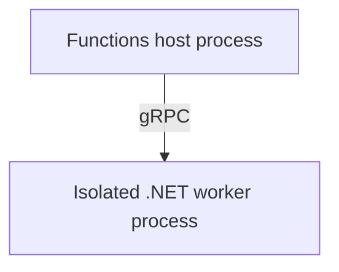

# In-Process vs Isolated Worker

> **Category:** Basics · **Status:** 📝 Draft note

> ⚠️ Support timelines for the in-process model are version-sensitive. Verify the current support status against official documentation.

## What it is

<!-- Define both models: in-process runs your code inside the Functions host process; isolated runs it in a separate .NET worker process communicating over gRPC. -->

<ENTER-DEFINITION>

## Why it is used

<!-- Why the isolated model exists: independent .NET version, full control of DI and middleware, fewer assembly conflicts. -->

- <ENTER-REASON>

## How it works

<!-- Add a small diagram showing host process and worker process. -->



## Important components

| Aspect | In-process | Isolated worker |
| --- | --- | --- |
| Process | <ENTER-DETAIL> | <ENTER-DETAIL> |
| .NET version coupling | <ENTER-DETAIL> | <ENTER-DETAIL> |
| DI setup | <ENTER-DETAIL> | <ENTER-DETAIL> |
| Middleware | <ENTER-DETAIL> | <ENTER-DETAIL> |
| Packages | `Microsoft.Azure.WebJobs.*` | `Microsoft.Azure.Functions.Worker.*` |

## Simple example

<!-- Show the same function written both ways so differences in attributes and namespaces are obvious. -->

**Simplified example**

```csharp
// <ENTER-CODE>
```

## Common mistakes

- ❌ <ENTER-MISTAKE — e.g. mixing WebJobs and Worker packages in one project>

## Quick summary

📌 <ENTER-SUMMARY>

## Related notes

- [Dependency Injection in Isolated Worker](../02-Question-Answer/Dependency-Injection-in-Isolated-Worker.md)
- [Project Structure](Project-Structure.md)

---

[⬅️ Previous: Triggers and Bindings](Triggers-and-Bindings.md) · [Index](index.md) · [Next: Project Structure ➡️](Project-Structure.md)
