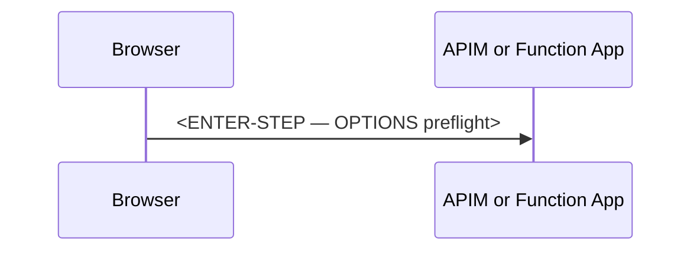

# When do I need CORS, and when does API Management replace it?

> **Category:** Question and Answer · **Status:** 📝 Draft note

## 1. Question

<!-- e.g. My SPA calls my Function App. Should I configure CORS on the Function App, in API Management, or both? -->

<ENTER-QUESTION>

## 2. Short answer

<ENTER-SHORT-ANSWER>

## 3. Detailed explanation

<!-- Define CORS first: a browser-enforced mechanism; servers only send headers. Explain preflight (OPTIONS). Explain that CORS is NOT an authentication or security boundary for non-browser clients. -->

<ENTER-DETAILED-EXPLANATION>

## 4. How it works



## 5. Local development behavior

<!-- Core Tools CORS settings in local.settings.json ("Host": { "CORS": "..." }). -->

<ENTER-LOCAL-BEHAVIOR>

## 6. Azure production behavior

<!-- Platform CORS settings vs APIM cors policy. Explain the risk of configuring both (duplicate or conflicting headers). Verify against current official documentation. -->

<ENTER-AZURE-BEHAVIOR>

## 7. C# isolated-worker example

<!-- CORS is usually configured on the platform or gateway, not in function code. Show configuration instead, and note that in-code CORS middleware is rarely needed. -->

**Conceptual example**

```xml
<!-- <ENTER-CODE — APIM cors policy> -->
```

## 8. Common misunderstanding

- ❌ <ENTER-MISUNDERSTANDING — e.g. "CORS protects my API from unauthorised callers">
- ✅ <ENTER-CORRECTION>

## 9. Recommended approach

✅ <ENTER-SOLUTION>

## 10. When not to use it

- <ENTER-EXCEPTION — e.g. server-to-server calls do not need CORS>

## 11. Related questions

- [Rate Limiter vs Load Balancer](Rate-Limiter-vs-Load-Balancer.md)
- [AP-004 High-Traffic HTTP Function](../03-Architecture-Problems/AP-004-High-Traffic-HTTP-Function.md)

## 12. Quick revision answer

📌 <ENTER-ONE-LINE-ANSWER>

---

[⬅️ Previous: Dependency Injection in Isolated Worker](Dependency-Injection-in-Isolated-Worker.md) · [Index](index.md) · [Next: Rate Limiter vs Load Balancer ➡️](Rate-Limiter-vs-Load-Balancer.md)
