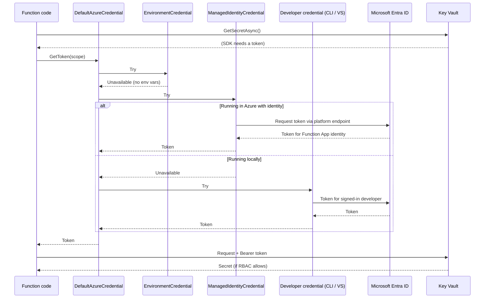

# How does DefaultAzureCredential behave locally vs in Azure?

> **Category:** Question and Answer · **Status:** Complete sample note · **Applies to:** Azure.Identity for .NET, Azure Functions isolated worker

> ⚠️ The exact list and order of credentials inside `DefaultAzureCredential` changes between Azure.Identity versions. Verify against current official documentation for the version you use.

---

## 1. Question

I use `DefaultAzureCredential` in my Azure Function. It works on my laptop, but how does it decide which identity to use, and why might it behave differently after deployment to Azure?

## 2. Short answer

`DefaultAzureCredential` is a **chain of credentials** that it tries in order until one succeeds. On your laptop it usually succeeds with a **developer credential** (Visual Studio, Azure CLI, Azure PowerShell or Azure Developer CLI), so it acts as **you**. In Azure it usually succeeds with **Managed Identity**, so it acts as the **Function App's identity**. Code is identical, but the **identity is different**, so permissions, tenants and network paths can be different too.

## 3. Detailed explanation

### Key terms

- **Credential** — an object that can obtain an access token from Microsoft Entra ID.
- **Token** — a short-lived bearer token for a specific **audience/scope** (for example `https://vault.azure.net/.default`).
- **Managed Identity** — an Entra ID identity Azure creates for a resource. Your code never sees a secret.
  - **System-assigned:** tied to one resource's lifecycle.
  - **User-assigned:** a standalone resource that can be attached to many resources.
- **RBAC role assignment** — permission granted to an identity on a scope (for example *Key Vault Secrets User* on a vault).

### Why a chain?

The same code needs to run in many environments without `if (isLocal)` branches. `DefaultAzureCredential` checks each source in turn. Simplified order (verify for your version):

| Order | Credential | Typically succeeds when… |
| --- | --- | --- |
| 1 | Environment | `AZURE_CLIENT_ID`, `AZURE_TENANT_ID` and a secret or certificate are set as environment variables. |
| 2 | Workload Identity | Running in Kubernetes with workload identity configured. |
| 3 | Managed Identity | Running on an Azure resource with an identity enabled. |
| 4 | Developer tools (Visual Studio, Azure CLI, Azure PowerShell, Azure Developer CLI) | A developer is signed in locally. |
| 5 | Interactive browser | Excluded by default. |

💡 The **first credential that returns a token wins**. A credential that is "unavailable" makes the chain move on. A credential that is available but **fails** (for example, wrong tenant) may stop the chain with an error, depending on version and credential type.

## 4. How it works



The SDK client caches tokens and refreshes them before expiry, which is one reason to **reuse SDK clients** rather than create them per invocation.

## 5. Local development behavior

- Managed Identity is **not available** on a laptop, so the chain falls through to **developer credentials**.
- The identity is **your user account**, in whichever tenant your tool is signed in to.
- Typical sign-in:

```bash
az login
az account show   # confirm the expected tenant and subscription
```

- Your **user** needs RBAC roles on the target resources (for example *Key Vault Secrets User*, *Azure Service Bus Data Sender*).
- If you have several accounts or tenants, the wrong one may be used. Set the tenant explicitly in options if needed.
- Network: your laptop reaches resources over the **public endpoint** unless you use VPN. A resource with public access disabled will fail locally.

## 6. Azure production behavior

- Managed Identity is available **only if enabled** on the Function App (system-assigned or user-assigned).
- The identity is the **Function App's service principal**, not any developer.
- The identity needs **its own** RBAC role assignments. Your personal permissions do not carry over.
- With a **user-assigned identity**, you usually must tell the credential which one to use (`ManagedIdentityClientId`), especially if more than one is attached.
- Role assignments can take several minutes to take effect after creation.
- Network: the function reaches resources over its configured outbound path (public, VNet integration, private endpoints). Behaviour depends on hosting plan and networking configuration.

| Concern | Local | Azure |
| --- | --- | --- |
| Credential that usually wins | Developer (CLI / VS) | Managed Identity |
| Identity | Your user | Function App identity |
| Who needs RBAC | You | The managed identity |
| Tenant | Whatever your tool is signed in to | The Function App's tenant |
| Network path | Laptop → public endpoint | Function App outbound (may be VNet) |

## 7. C# isolated-worker example

**Production-oriented example** — register Azure SDK clients once, with a credential configured per environment. Package names: `Azure.Identity`, `Azure.Security.KeyVault.Secrets`, `Azure.Messaging.ServiceBus`, `Microsoft.Extensions.Azure`.

`Program.cs`:

```csharp
using Azure.Identity;
using Microsoft.Azure.Functions.Worker;
using Microsoft.Extensions.Azure;
using Microsoft.Extensions.Configuration;
using Microsoft.Extensions.DependencyInjection;
using Microsoft.Extensions.Hosting;

var host = new HostBuilder()
    .ConfigureFunctionsWebApplication()
    .ConfigureServices((context, services) =>
    {
        IConfiguration config = context.Configuration;

        services.AddApplicationInsightsTelemetryWorkerService();
        services.ConfigureFunctionsApplicationInsights();

        services.AddAzureClients(clients =>
        {
            // One credential instance shared by all Azure SDK clients.
            var credentialOptions = new DefaultAzureCredentialOptions
            {
                // Required when a user-assigned identity is used in Azure.
                // Empty locally, so developer credentials are used.
                ManagedIdentityClientId = config["AZURE_CLIENT_ID"],
            };

            // Optional: make local behaviour predictable and faster.
            if (context.HostingEnvironment.IsDevelopment())
            {
                credentialOptions.ExcludeManagedIdentityCredential = true;
            }

            clients.UseCredential(new DefaultAzureCredential(credentialOptions));

            clients.AddSecretClient(new Uri(config["KeyVault:VaultUri"]
                ?? throw new InvalidOperationException("KeyVault:VaultUri is not configured.")));

            clients.AddServiceBusClientWithNamespace(config["ServiceBus:FullyQualifiedNamespace"]
                ?? throw new InvalidOperationException("ServiceBus:FullyQualifiedNamespace is not configured."));
        });
    })
    .Build();

host.Run();
```

`GetConfigFunction.cs`:

```csharp
using Azure;
using Azure.Security.KeyVault.Secrets;
using Microsoft.AspNetCore.Http;
using Microsoft.AspNetCore.Mvc;
using Microsoft.Azure.Functions.Worker;
using Microsoft.Extensions.Logging;

public sealed class GetConfigFunction
{
    private readonly SecretClient _secrets;
    private readonly ILogger<GetConfigFunction> _logger;

    public GetConfigFunction(SecretClient secrets, ILogger<GetConfigFunction> logger)
    {
        _secrets = secrets;
        _logger = logger;
    }

    [Function("GetConfig")]
    public async Task<IActionResult> Run(
        [HttpTrigger(AuthorizationLevel.Function, "get")] HttpRequest req,
        CancellationToken cancellationToken)
    {
        try
        {
            KeyVaultSecret secret = await _secrets.GetSecretAsync("<YOUR-SECRET-NAME>", cancellationToken: cancellationToken);
            // Never log or return the secret value.
            _logger.LogInformation("Secret {SecretName} retrieved, version {Version}", secret.Name, secret.Properties.Version);
            return new OkObjectResult(new { retrieved = true });
        }
        catch (RequestFailedException ex) when (ex.Status == 403)
        {
            _logger.LogError(ex, "Identity lacks permission on Key Vault");
            return new StatusCodeResult(StatusCodes.Status500InternalServerError);
        }
    }
}
```

`local.settings.json` (local only, never committed with real values):

```json
{
  "IsEncrypted": false,
  "Values": {
    "AzureWebJobsStorage": "UseDevelopmentStorage=true",
    "FUNCTIONS_WORKER_RUNTIME": "dotnet-isolated",
    "AZURE_FUNCTIONS_ENVIRONMENT": "Development",
    "KeyVault__VaultUri": "<YOUR-KEY-VAULT-URL>",
    "ServiceBus__FullyQualifiedNamespace": "<YOUR-SERVICE-BUS-NAMESPACE>.servicebus.windows.net"
  }
}
```

Azure app settings (set on the Function App):

```json
[
  { "name": "KeyVault__VaultUri", "value": "<YOUR-KEY-VAULT-URL>" },
  { "name": "ServiceBus__FullyQualifiedNamespace", "value": "<YOUR-SERVICE-BUS-NAMESPACE>.servicebus.windows.net" },
  { "name": "AZURE_CLIENT_ID", "value": "<YOUR-USER-ASSIGNED-IDENTITY-CLIENT-ID>" }
]
```

> 💡 `AZURE_CLIENT_ID` is only needed for a **user-assigned** identity. Omit it for system-assigned.

## 8. Common misunderstanding

| ❌ Misunderstanding | ✅ Reality |
| --- | --- |
| "It worked locally, so the permissions are correct." | Locally **your user** had the role. The Function App identity needs its own role assignment. |
| "`DefaultAzureCredential` is Managed Identity." | It is a **chain**; Managed Identity is one member. |
| "Enabling Managed Identity is enough." | You also need **RBAC role assignments** on each target resource, at the right scope. |
| "Setting `AZURE_CLIENT_ID` is harmless." | If `AZURE_TENANT_ID` and a secret are also present, `EnvironmentCredential` may win instead of Managed Identity. |
| "Owner/Contributor gives data access." | Management-plane roles do not automatically grant **data-plane** access (for example reading secrets or sending messages). |

## 9. Recommended approach

✅ Based on the assumption that the app runs on Azure and developers use Azure CLI or Visual Studio locally:

1. Use `DefaultAzureCredential` (or `ChainedTokenCredential` with only the credentials you need) through `AddAzureClients`.
2. Create **one credential** and **one client per service**, registered as singletons.
3. Use a **user-assigned identity** when several apps share access, or when you want the identity to survive app recreation; set `ManagedIdentityClientId`.
4. Assign **least-privilege data-plane roles** to both the managed identity (Azure) and developers (non-production resources).
5. In production, consider using `ManagedIdentityCredential` directly to avoid accidental fallback to other credentials.
6. Log **which identity** is in use at startup (client ID, not tokens) to speed up diagnosis.

## 10. When not to use it

- **Production where determinism matters most** — use `ManagedIdentityCredential` explicitly, so a stray environment variable cannot change the identity.
- **Non-Azure hosting without workload identity** — a service principal with a certificate via `ClientCertificateCredential` may be clearer.
- **Calling non-Entra-protected APIs** — tokens do not help; use the API's own auth mechanism, storing any secret in Key Vault.

## 11. Related questions

- [How should connections be managed with Managed Identity?](Managed-Identity-Connection-Management.md)
- [PS-005 Authentication Failure](../05-Production-Scenarios/PS-005-Authentication-Failure.md)
- [PS-001 Works Locally, Fails in Azure](../05-Production-Scenarios/PS-001-Works-Locally-Fails-in-Azure.md)
- [AP-005 Secure Secretless Architecture](../03-Architecture-Problems/AP-005-Secure-Secretless-Architecture.md)
- [Authentication Issues checklist](../06-Debugging-Troubleshooting/Authentication-Issues.md)

## 12. Quick revision answer

📌 `DefaultAzureCredential` tries credentials in order; locally it usually authenticates **as the developer**, in Azure **as the Function App's managed identity** — so the managed identity needs its own RBAC roles, and user-assigned identities need `ManagedIdentityClientId`.

---

[⬅️ Previous: Rate Limiter vs Load Balancer](Rate-Limiter-vs-Load-Balancer.md) · [Index](index.md) · [Next: Managed Identity Connection Management ➡️](Managed-Identity-Connection-Management.md)
