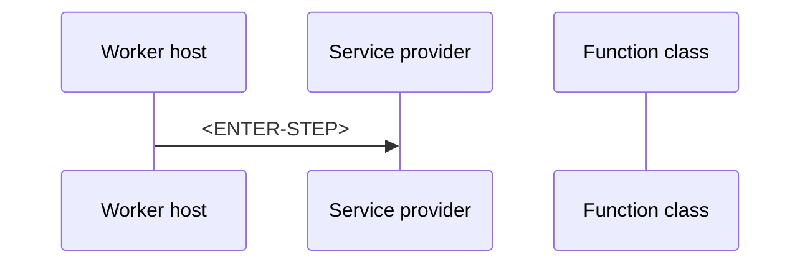

# How do I use Dependency Injection in the isolated worker?

> **Category:** Question and Answer · **Status:** 📝 Draft note · **Applies to:** .NET isolated worker

## 1. Question

<!-- e.g. Where do I register services in an isolated-worker Function App, which lifetimes are safe, and how is this different from the in-process FunctionsStartup approach? -->

<ENTER-QUESTION>

## 2. Short answer

<ENTER-SHORT-ANSWER>

## 3. Detailed explanation

<!-- Cover: registration in Program.cs (ConfigureServices or builder.Services), constructor injection into function classes, singleton/scoped/transient lifetimes, scope per invocation. -->

<ENTER-DETAILED-EXPLANATION>

## 4. How it works

<!-- Diagram: host builds container at startup → per invocation a scope is created → function class resolved → scoped services disposed after invocation. Verify scope behaviour against current docs. -->



## 5. Local development behavior

<ENTER-LOCAL-BEHAVIOR>

## 6. Azure production behavior

<!-- Startup failures due to DI appear as host errors; mention where to find them (Log stream, Application Insights traces). -->

<ENTER-AZURE-BEHAVIOR>

## 7. C# isolated-worker example

**Simplified example**

```csharp
// <ENTER-CODE — Program.cs registration + function class with constructor injection>
```

## 8. Common misunderstanding

- ❌ <ENTER-MISUNDERSTANDING — e.g. injecting a scoped service into a singleton>
- ✅ <ENTER-CORRECTION>

## 9. Recommended approach

✅ <ENTER-SOLUTION>

## 10. When not to use it

- <ENTER-EXCEPTION>

## 11. Related questions

- [In-Process vs Isolated Worker](../01-Basics/In-Process-vs-Isolated-Worker.md)
- [Dependency Injection Issues](../06-Debugging-Troubleshooting/Dependency-Injection-Issues.md)

## 12. Quick revision answer

📌 <ENTER-ONE-LINE-ANSWER>

---

[Index](index.md) · [Next: CORS vs API Management ➡️](CORS-vs-API-Management.md)
