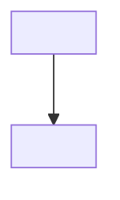

# How should connections be managed with Managed Identity?

> **Category:** Question and Answer · **Status:** 📝 Draft note

## 1. Question

<!-- e.g. How do I connect triggers, bindings and SDK clients to Service Bus, Storage and Key Vault using Managed Identity instead of connection strings — and how should those clients be reused? -->

<ENTER-QUESTION>

## 2. Short answer

<ENTER-SHORT-ANSWER>

## 3. Detailed explanation

<!-- Two distinct areas: (a) identity-based connections for triggers/bindings via app settings like <Prefix>__fullyQualifiedNamespace, <Prefix>__credential, <Prefix>__clientId; (b) Azure SDK clients registered via AddAzureClients. Explain singleton reuse and token caching. -->

<ENTER-DETAILED-EXPLANATION>

## 4. How it works



## 5. Local development behavior

<ENTER-LOCAL-BEHAVIOR>

## 6. Azure production behavior

<!-- Required RBAC roles per service (e.g. Service Bus Data Receiver, Storage Blob Data Owner for AzureWebJobsStorage). Verify role names and requirements in official documentation. -->

<ENTER-AZURE-BEHAVIOR>

## 7. C# isolated-worker example

**Production-oriented example**

```csharp
// <ENTER-CODE>
```

```json
{
  "<ENTER-CONNECTION-PREFIX>__fullyQualifiedNamespace": "<YOUR-SERVICE-BUS-NAMESPACE>.servicebus.windows.net"
}
```

## 8. Common misunderstanding

- ❌ <ENTER-MISUNDERSTANDING>
- ✅ <ENTER-CORRECTION>

## 9. Recommended approach

✅ <ENTER-SOLUTION>

## 10. When not to use it

- <ENTER-EXCEPTION>

## 11. Related questions

- [DefaultAzureCredential: Local vs Azure](DefaultAzureCredential-Local-vs-Azure.md)
- [AP-005 Secure Secretless Architecture](../03-Architecture-Problems/AP-005-Secure-Secretless-Architecture.md)
- [Configuration Cheatsheet](../08-Quick-Reference/Configuration-Cheatsheet.md)

## 12. Quick revision answer

📌 <ENTER-ONE-LINE-ANSWER>

---

[⬅️ Previous: DefaultAzureCredential Local vs Azure](DefaultAzureCredential-Local-vs-Azure.md) · [Index](index.md) · [Next: Function Scaling Questions ➡️](Function-Scaling-Questions.md)
