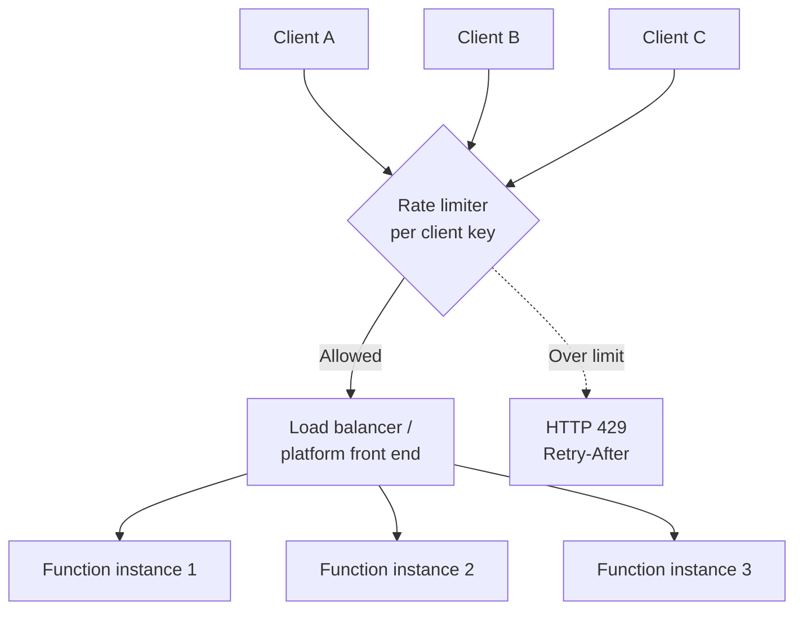

# What is the difference between a rate limiter and a load balancer?

> **Category:** Question and Answer · **Status:** Complete sample note · **Applies to:** Azure Functions isolated worker, .NET 8+, API Management

---

## 1. Question

A rate limiter and a load balancer both sit in the request path and both "control traffic". What is the actual difference, and which one do I need in front of — or inside — an Azure Function App?

## 2. Short answer

A **load balancer distributes** requests across several backends so that no single backend is overloaded. It does **not reduce** the total number of requests.

A **rate limiter restricts** how many requests are allowed in a time window. It **rejects or delays** requests above the limit.

They solve different problems and are often used **together**: the load balancer spreads load across Function App instances, and a rate limiter protects a client, a tenant or a downstream dependency from too much traffic.

## 3. Detailed explanation

### Definitions

- **Load balancing** — routing each incoming request to one of several healthy targets using an algorithm (round robin, least connections, hashing, and others). Goal: **utilisation and availability**.
- **Rate limiting** — counting requests per **key** (client, IP, subscription, tenant, or global) and enforcing a maximum per time window. Goal: **protection and fairness**.
- **Throttling** — often used as a synonym for rate limiting. Some people use it specifically for *slowing down* rather than *rejecting*.
- **Quota** — a limit over a long period (for example 1 million calls per month).

### Side-by-side

| Aspect | Load balancer | Rate limiter |
| --- | --- | --- |
| Primary question | *Where* should this request go? | *Should* this request be allowed now? |
| Effect on total traffic | None — total is preserved | Reduces accepted traffic |
| Typical response when overloaded | Route elsewhere, or fail if all targets unhealthy | HTTP 429 *Too Many Requests*, often with `Retry-After` |
| State needed | Backend health and connection counts | Counters per key per window |
| Protects | Backends from uneven load | Backends, dependencies and other tenants from excessive load |
| Azure examples | Front Door, Application Gateway, Azure Load Balancer, the Functions platform front end | API Management `rate-limit` / `rate-limit-by-key`, ASP.NET Core rate limiting, custom Redis-based limiter |

### Where they exist around a Function App

- Azure Functions already has a **platform front end** that distributes HTTP requests across running instances. You do not configure this load balancing yourself.
- **Scaling out** increases capacity; it is not rate limiting. More instances can actually **increase** pressure on a downstream API.
- Rate limiting must be **added deliberately**: at the gateway (APIM), in code, or both.

> 💡 A load balancer helps when *your* service is the bottleneck. A rate limiter helps when you need to **protect** something — your service, a shared resource or a downstream API — from more traffic than it can or should accept.

## 4. How it works



**Rate limiter algorithms (brief):**

| Algorithm | Idea | Behaviour |
| --- | --- | --- |
| Fixed window | Count per fixed interval (e.g. per minute) | Simple; allows bursts at window edges. |
| Sliding window | Weighted count across current and previous window | Smoother than fixed window. |
| Token bucket | Tokens refill at a steady rate; each request consumes one | Allows controlled bursts up to bucket size. |
| Concurrency limiter | Limits in-flight requests, not rate | Protects resources sensitive to parallelism. |

## 5. Local development behavior

- Locally there is **one** Function host process. There is no load balancer in front of it.
- An in-code rate limiter (for example `System.Threading.RateLimiting`) behaves exactly as configured because **all requests hit one instance**.
- This gives a misleading impression that a per-process limiter enforces a global limit.

## 6. Azure production behavior

- The platform distributes HTTP requests across **N instances**. N changes as the app scales, and depends on hosting plan and scale settings.
- An **in-memory** rate limiter enforces its limit **per instance**. Effective global limit ≈ `per-instance limit × number of instances`.
- A **gateway** limiter (APIM) or a **distributed** limiter (shared store such as Redis) is needed for a true global or per-client limit.
- APIM rate-limit counters may be per gateway instance or synchronised, depending on the tier and policy. Verify against current official documentation.

> ⚠️ "We added a rate limiter and still got HTTP 429 from the downstream API" usually means the limiter was **per instance** while the downstream limit is **global**. See [AP-001](../03-Architecture-Problems/AP-001-Downstream-API-Throttling.md).

## 7. C# isolated-worker example

**Simplified example** — a per-instance token bucket protecting a downstream call. This limits each instance only; it is **not** a global limit.

```csharp
using System.Threading.RateLimiting;
using Microsoft.Extensions.DependencyInjection;
using Microsoft.Extensions.Hosting;

var host = new HostBuilder()
    .ConfigureFunctionsWebApplication()
    .ConfigureServices(services =>
    {
        // One limiter per process (singleton). Each instance has its own.
        services.AddSingleton<RateLimiter>(_ => new TokenBucketRateLimiter(new TokenBucketRateLimiterOptions
        {
            TokenLimit = 10,                         // burst size
            TokensPerPeriod = 5,                     // refill amount
            ReplenishmentPeriod = TimeSpan.FromSeconds(1),
            QueueLimit = 20,                         // wait instead of failing immediately
            QueueProcessingOrder = QueueProcessingOrder.OldestFirst,
            AutoReplenishment = true
        }));

        services.AddHttpClient("downstream", c => c.BaseAddress = new Uri("<YOUR-API-ENDPOINT>"));
    })
    .Build();

host.Run();
```

```csharp
using System.Threading.RateLimiting;
using Microsoft.AspNetCore.Http;
using Microsoft.AspNetCore.Mvc;
using Microsoft.Azure.Functions.Worker;
using Microsoft.Extensions.Logging;

public sealed class ProxyFunction
{
    private readonly RateLimiter _limiter;
    private readonly IHttpClientFactory _httpClientFactory;
    private readonly ILogger<ProxyFunction> _logger;

    public ProxyFunction(RateLimiter limiter, IHttpClientFactory httpClientFactory, ILogger<ProxyFunction> logger)
    {
        _limiter = limiter;
        _httpClientFactory = httpClientFactory;
        _logger = logger;
    }

    [Function("Proxy")]
    public async Task<IActionResult> Run(
        [HttpTrigger(AuthorizationLevel.Function, "get")] HttpRequest req,
        CancellationToken cancellationToken)
    {
        using RateLimitLease lease = await _limiter.AcquireAsync(1, cancellationToken);

        if (!lease.IsAcquired)
        {
            _logger.LogWarning("Local rate limit exceeded");
            req.HttpContext.Response.Headers.RetryAfter = "1";
            return new StatusCodeResult(StatusCodes.Status429TooManyRequests);
        }

        HttpClient client = _httpClientFactory.CreateClient("downstream");
        using HttpResponseMessage response = await client.GetAsync("resource", cancellationToken);
        return new StatusCodeResult((int)response.StatusCode);
    }
}
```

**Conceptual example** — a per-client limit at the gateway using API Management policy (verify policy syntax for your APIM tier):

```xml
<inbound>
    <base />
    <rate-limit-by-key calls="100"
                       renewal-period="60"
                       counter-key="@(context.Subscription?.Id ?? context.Request.IpAddress)" />
</inbound>
```

## 8. Common misunderstanding

| ❌ Misunderstanding | ✅ Reality |
| --- | --- |
| "A load balancer prevents overload." | It spreads load. If total load exceeds total capacity, every backend is overloaded. |
| "Auto-scaling is a form of rate limiting." | Scaling adds capacity and can **increase** pressure on downstream dependencies. |
| "An in-memory limiter enforces a global limit." | Only when there is exactly one instance. |
| "Rate limiting is only for public APIs." | It is equally important for protecting **outbound** calls to limited dependencies. |

## 9. Recommended approach

✅ Assuming an HTTP-triggered Function App exposed to multiple clients and calling a limited downstream service:

1. Rely on the platform for **load balancing** across instances; add Front Door or Application Gateway only for needs such as global routing, WAF or multi-region.
2. Apply **inbound per-client rate limiting** at the gateway (APIM) to protect your app and ensure fairness.
3. Protect **outbound** dependencies separately. If the dependency limit is global, use queue-based load leveling or a distributed limiter rather than a per-instance limiter.
4. Return **HTTP 429 with `Retry-After`** so well-behaved clients back off.
5. Monitor accepted vs rejected requests per key.

## 10. When not to use it

- Do **not** add a custom load balancer in front of a single Function App just to distribute load — the platform already does this.
- Do **not** add a rate limiter where the real requirement is **absorbing bursts without rejecting** — use a queue instead.
- Do **not** rely on a per-instance limiter for a global contractual limit.

## 11. Related questions

- [How do Azure Functions scale?](Function-Scaling-Questions.md)
- [When do I need CORS, and when does API Management replace it?](CORS-vs-API-Management.md)
- [AP-001 Downstream API Throttling](../03-Architecture-Problems/AP-001-Downstream-API-Throttling.md)
- [AP-004 High-Traffic HTTP Function](../03-Architecture-Problems/AP-004-High-Traffic-HTTP-Function.md)

## 12. Quick revision answer

📌 A load balancer decides **where** a request goes and keeps total traffic the same; a rate limiter decides **whether** a request is allowed now and reduces accepted traffic — and on a scaled-out Function App an in-memory limiter is only **per instance**.

---

[⬅️ Previous: CORS vs API Management](CORS-vs-API-Management.md) · [Index](index.md) · [Next: DefaultAzureCredential Local vs Azure ➡️](DefaultAzureCredential-Local-vs-Azure.md)
