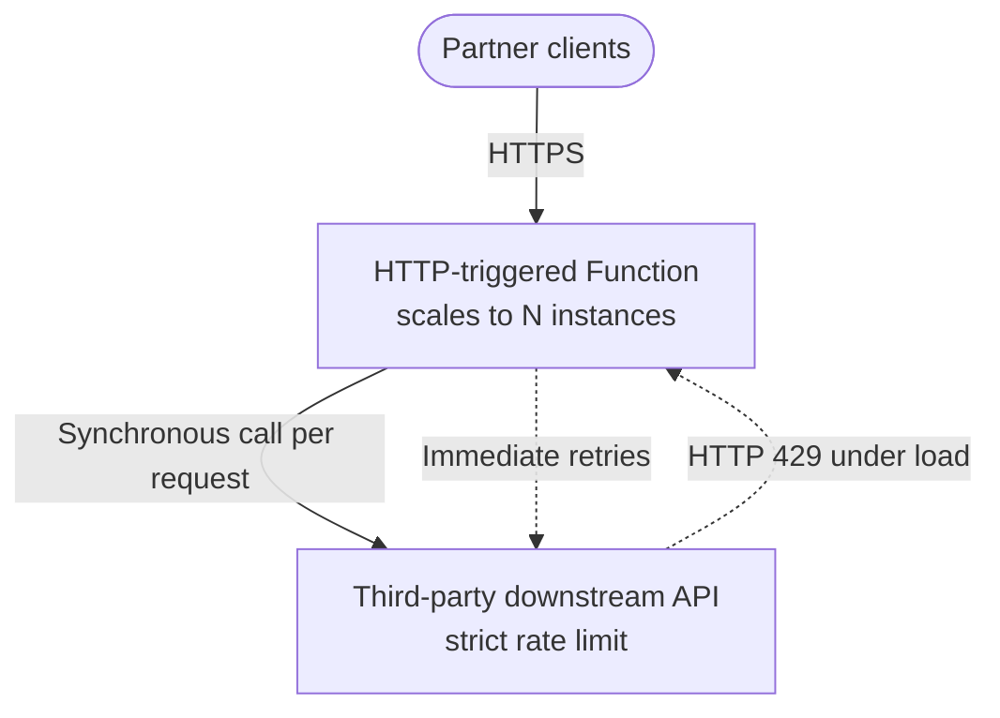
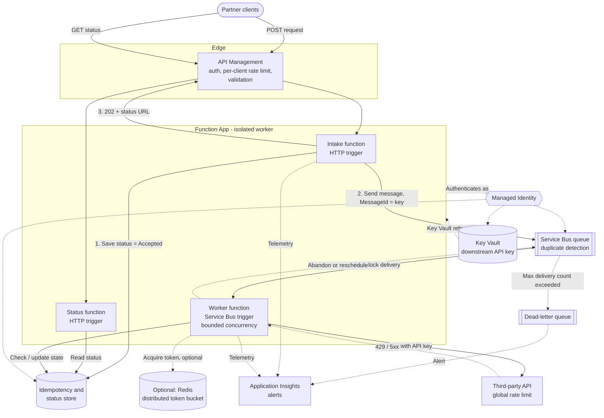
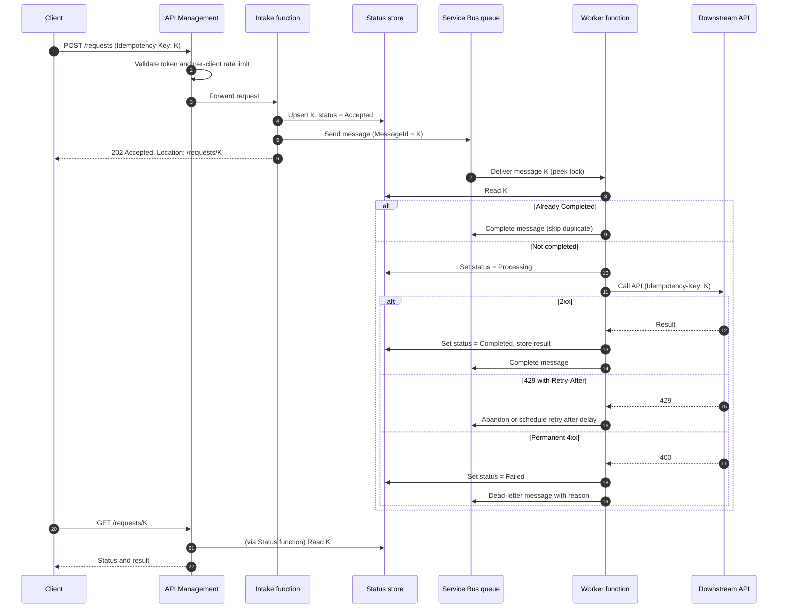

# AP-001: Downstream API Throttling

> **Category:** Architecture Problem · **Difficulty:** Advanced · **Status:** Complete sample note · **Applies to:** Azure Functions isolated worker (.NET 8+), Azure Service Bus, Azure API Management

> ⚠️ Scaling limits, APIM policy behaviour and Service Bus features vary by hosting plan, tier and version. Verify against current official documentation before applying numbers from this note.

---

## 1. Problem title

An HTTP-triggered Azure Function that scales out is overwhelming a rate-limited downstream API and receiving HTTP 429 responses.

## 2. Difficulty level

**Advanced.** The problem combines scaling behaviour, distributed rate limiting, messaging, resilience patterns and idempotency. No single component solves it on its own.

## 3. Problem statement

A partner-facing HTTP API is implemented as an Azure Function. For every incoming request, the function calls a third-party **downstream API** (for example, a shipping-label or credit-check provider) and returns the result.

During traffic spikes, Azure Functions scales out to many instances. The combined call rate exceeds the downstream API's limit, and the provider responds with **HTTP 429 Too Many Requests**. Retries make things worse. Some requests fail permanently, and some retries cause **duplicate operations** at the provider.

The downstream API is owned by a third party and **cannot be changed**.

## 4. Existing architecture



- Each request is processed **synchronously**: client → function → downstream API → response.
- Retries use a fixed short delay and no jitter.
- No shared coordination exists between function instances.
- The downstream API key is stored in an app setting as plain text.

## 5. Symptoms

- HTTP 429 responses from the downstream API increase sharply during peaks.
- Client-facing error rate and latency increase at the same time.
- Function instance count rises during the peak (visible in Application Insights *Live Metrics* or platform metrics).
- Some downstream operations are performed **twice** (for example, two labels created for one order).
- After peaks, the provider occasionally applies a **longer block** because of repeated limit violations (assumption based on provider behaviour; confirm with the provider).

## 6. Functional requirements

- **FR-1:** Every accepted client request must eventually be processed by the downstream API.
- **FR-2:** Each logical request must be processed **at most once** by the downstream API (no duplicate side effects).
- **FR-3:** Clients must be able to obtain the result of their request.
- **FR-4:** Requests that cannot be processed after all retries must be held for investigation and replay.

## 7. Non-functional requirements

| ID | Requirement | Target (assumed) |
| --- | --- | --- |
| NFR-1 | Respect the downstream limit | ≤ 50 requests/second globally (provider contract) |
| NFR-2 | Durability | No accepted request is lost |
| NFR-3 | Intake availability | 99.9% for the client-facing endpoint |
| NFR-4 | Latency | Results available within 2 minutes at peak; under 5 seconds off-peak |
| NFR-5 | Security | No secrets in code or plain-text settings; least-privilege identities |
| NFR-6 | Observability | 429 rate, queue depth, end-to-end latency and DLQ count visible and alerted |

## 8. Constraints

- **C-1:** The downstream API cannot be modified.
- **C-2:** The downstream limit is **global** across all callers using our API key.
- **C-3:** Incoming traffic is bursty; peaks can be 5–10× the average.
- **C-4:** The Function App can scale out to multiple instances.
- **C-5:** The downstream API authenticates with an API key (it does not support Entra ID).

## 9. Assumptions

- **A-1:** Clients can accept an **asynchronous** response (HTTP 202 + status endpoint or callback). *If not, see the alternatives section.*
- **A-2:** Peak load is **temporary** (minutes, not hours), so a backlog can be drained.
- **A-3:** The downstream API returns `Retry-After` on 429 responses (verify with the provider).
- **A-4:** Each client request carries, or can be given, a unique business key (for example `orderId`).
- **A-5:** The downstream API supports an idempotency key header **or** we can check whether an operation already exists. If neither is true, idempotency must be enforced entirely on our side.

## 10. Questions to consider

1. Is the downstream limit per second, per minute, or both? Is it per key, per IP or per account?
2. Do clients **need** a synchronous result, or is eventual completion acceptable?
3. Does the provider offer an idempotency key mechanism?
4. What is the maximum acceptable delay before a request is processed?
5. Are there priority classes of requests that should be processed first?
6. Is the 429 response accompanied by `Retry-After` or rate-limit headers?
7. Do other systems share the same downstream API key and therefore the same quota?

## 11. Root-cause analysis

| Symptom | Underlying cause | Evidence |
| --- | --- | --- |
| HTTP 429 at peaks | Total outbound rate = per-instance rate × instance count, which exceeds the global limit | 429 count correlates with instance count |
| Retries worsen the problem | Fixed-delay retries without jitter create synchronised retry storms | 429 spikes appear in waves at the retry interval |
| Duplicate operations | A timeout or 429 after the provider had already processed the request causes a retry of a completed operation | Duplicate provider IDs for one business key |
| Lost requests | Synchronous processing with a bounded retry count; once retries are exhausted the request fails with no durable copy | Client 5xx errors with no later completion |

💡 **Core insight:** Horizontal scaling increases the **inbound** capacity of the function, but the **outbound** capacity is fixed by the downstream API. The architecture has no element that decouples these two rates.

## 12. Recommended architecture

🧩 Based on assumptions A-1 to A-5, the recommendation is **queue-based load leveling** with a **rate-controlled consumer**:

1. **API Management** at the edge: authentication, per-client rate limits and request validation. It protects *our* system and ensures fairness between clients. It does **not** by itself protect the downstream API, because downstream calls originate from our functions.
2. **Intake function (HTTP trigger):** validates the request, assigns or reads the idempotency key, writes a status record, enqueues a message to **Service Bus**, and returns **HTTP 202 Accepted** with a status URL.
3. **Service Bus queue** with **duplicate detection** (based on `MessageId` = idempotency key) absorbs bursts durably.
4. **Worker function (Service Bus trigger)** with **bounded concurrency** (limited instances × limited concurrent calls per instance) calls the downstream API so the global rate stays below the limit.
5. **Resilience** in the worker: retry with exponential backoff and jitter honouring `Retry-After`, a circuit breaker, and per-attempt timeouts.
6. **Idempotency store** (for example Azure Table Storage or Cosmos DB) records the processing state per idempotency key, so a redelivered message does not repeat a completed downstream call.
7. **Dead-letter queue** captures messages that exceed the maximum delivery count; an alert fires and an operator can replay them.
8. **Managed Identity** for Service Bus, Storage and Key Vault. The downstream API key lives in **Key Vault** and is referenced, not stored in plain text.
9. **Application Insights** with correlation IDs across intake, queue and worker.

**When Redis is justified:** if the worker cannot be made the only caller (for example, a synchronous path must remain for some clients), or if fixed concurrency cannot keep the rate accurately below the limit, add a **distributed token bucket in Azure Cache for Redis** shared by all callers. It adds a dependency and latency, so do not add it by default.

## 13. Architecture diagram



## 14. Component responsibilities

| Component | Responsibility | Why it is required |
| --- | --- | --- |
| API Management | Client auth, per-client rate limits, request validation | Protects our intake and provides fairness; does not control downstream rate |
| Intake function | Validate, persist status, enqueue, return 202 | Decouples client traffic from downstream capacity |
| Service Bus queue | Durable buffer, duplicate detection, dead-lettering, delivery count | Satisfies "requests must not be lost" (NFR-2) and absorbs bursts |
| Worker function | Rate-controlled downstream calls with resilience | The only component that calls the downstream API, so its rate can be controlled |
| Idempotency/status store | State per idempotency key | Prevents duplicate side effects on redelivery (FR-2) and serves status queries (FR-3) |
| Key Vault | Stores downstream API key | Removes plain-text secret (NFR-5) |
| Managed Identity | Authenticates to Azure resources | No connection strings or keys for Azure services |
| Application Insights | Traces, metrics, alerts | Satisfies NFR-6 |
| Redis (optional) | Global token bucket | Only if concurrency limits alone cannot hold the rate under the limit |

## 15. End-to-end request or event flow



## 16. C# implementation approach

### 16.1 Program.cs

**Production-oriented example** — the structure is production-oriented; the policy values are assumptions and must be tuned. Packages: `Microsoft.Azure.Functions.Worker`, `Microsoft.Azure.Functions.Worker.Extensions.Http.AspNetCore`, `Microsoft.Azure.Functions.Worker.Extensions.ServiceBus`, `Microsoft.Extensions.Azure`, `Azure.Identity`, `Azure.Data.Tables`, `Microsoft.Extensions.Http.Resilience`.

```csharp
using Azure.Identity;
using Microsoft.Azure.Functions.Worker;
using Microsoft.Extensions.Azure;
using Microsoft.Extensions.Configuration;
using Microsoft.Extensions.DependencyInjection;
using Microsoft.Extensions.Hosting;
using Microsoft.Extensions.Http.Resilience;
using Polly;

var host = new HostBuilder()
    .ConfigureFunctionsWebApplication()
    .ConfigureServices((context, services) =>
    {
        IConfiguration config = context.Configuration;

        services.AddApplicationInsightsTelemetryWorkerService();
        services.ConfigureFunctionsApplicationInsights();

        // Strongly typed options with validation at startup.
        services.AddOptions<DownstreamApiOptions>()
            .Bind(config.GetSection(DownstreamApiOptions.SectionName))
            .ValidateDataAnnotations()
            .ValidateOnStart();

        // Azure SDK clients with Managed Identity.
        services.AddAzureClients(clients =>
        {
            clients.UseCredential(new DefaultAzureCredential(new DefaultAzureCredentialOptions
            {
                ManagedIdentityClientId = config["AZURE_CLIENT_ID"]
            }));

            clients.AddServiceBusClientWithNamespace(config["ServiceBus:FullyQualifiedNamespace"]
                ?? throw new InvalidOperationException("ServiceBus:FullyQualifiedNamespace is not configured."));

            clients.AddTableServiceClient(new Uri(config["StatusStore:TableServiceUri"]
                ?? throw new InvalidOperationException("StatusStore:TableServiceUri is not configured.")));
        });

        services.AddSingleton<IRequestStatusStore, TableRequestStatusStore>();

        // Typed HttpClient with resilience pipeline.
        services.AddHttpClient<IDownstreamApiClient, DownstreamApiClient>((sp, client) =>
            {
                var options = sp.GetRequiredService<Microsoft.Extensions.Options.IOptions<DownstreamApiOptions>>().Value;
                client.BaseAddress = new Uri(options.BaseUrl);
                client.Timeout = Timeout.InfiniteTimeSpan; // Timeouts are handled by the pipeline.
            })
            .AddResilienceHandler("downstream", builder =>
            {
                // Total time budget for one invocation's call, including retries.
                builder.AddTimeout(TimeSpan.FromSeconds(60));

                // Retry transient failures with exponential backoff and jitter.
                // Honours Retry-After when present (behaviour of the default delay generator; verify for your version).
                builder.AddRetry(new HttpRetryStrategyOptions
                {
                    MaxRetryAttempts = 3,
                    BackoffType = DelayBackoffType.Exponential,
                    UseJitter = true,
                    Delay = TimeSpan.FromSeconds(2)
                });

                // Stop calling when the downstream API is clearly unhealthy.
                builder.AddCircuitBreaker(new HttpCircuitBreakerStrategyOptions
                {
                    FailureRatio = 0.5,
                    MinimumThroughput = 20,
                    SamplingDuration = TimeSpan.FromSeconds(30),
                    BreakDuration = TimeSpan.FromSeconds(30)
                });

                // Per-attempt timeout.
                builder.AddTimeout(TimeSpan.FromSeconds(10));
            });
    })
    .Build();

host.Run();
```

> 💡 In-invocation retries are kept **short** (3 attempts). Longer waits are delegated to **Service Bus redelivery**, so the function does not hold a message lock or consume an instance while waiting.

### 16.2 Options

**Simplified example**

```csharp
using System.ComponentModel.DataAnnotations;

public sealed class DownstreamApiOptions
{
    public const string SectionName = "DownstreamApi";

    [Required, Url]
    public string BaseUrl { get; init; } = string.Empty;

    // Resolved from a Key Vault reference app setting. Never hard-code.
    [Required]
    public string ApiKey { get; init; } = string.Empty;
}
```

### 16.3 Intake function

**Production-oriented example** (validation simplified)

```csharp
using System.Text.Json;
using Azure.Messaging.ServiceBus;
using Microsoft.AspNetCore.Http;
using Microsoft.AspNetCore.Mvc;
using Microsoft.Azure.Functions.Worker;
using Microsoft.Extensions.Logging;

public sealed record LabelRequest(string OrderId, string Destination);

public sealed class IntakeFunction
{
    private const string QueueName = "label-requests";
    private readonly ServiceBusSender _sender;
    private readonly IRequestStatusStore _statusStore;
    private readonly ILogger<IntakeFunction> _logger;

    public IntakeFunction(ServiceBusClient serviceBusClient, IRequestStatusStore statusStore, ILogger<IntakeFunction> logger)
    {
        // ServiceBusSender is thread-safe and intended to be reused.
        _sender = serviceBusClient.CreateSender(QueueName);
        _statusStore = statusStore;
        _logger = logger;
    }

    [Function("SubmitLabelRequest")]
    public async Task<IActionResult> Run(
        [HttpTrigger(AuthorizationLevel.Function, "post", Route = "requests")] HttpRequest req,
        CancellationToken cancellationToken)
    {
        LabelRequest? body = await JsonSerializer.DeserializeAsync<LabelRequest>(
            req.Body, new JsonSerializerOptions(JsonSerializerDefaults.Web), cancellationToken);

        if (body is null || string.IsNullOrWhiteSpace(body.OrderId))
        {
            return new BadRequestObjectResult(new { error = "OrderId is required." });
        }

        // Prefer a client-supplied key; fall back to a deterministic business key.
        string idempotencyKey = req.Headers.TryGetValue("Idempotency-Key", out var key) && !string.IsNullOrWhiteSpace(key)
            ? key.ToString()
            : $"label-{body.OrderId}";

        string correlationId = req.Headers.TryGetValue("x-correlation-id", out var cid) ? cid.ToString() : Guid.NewGuid().ToString();

        using (_logger.BeginScope(new Dictionary<string, object>
        {
            ["IdempotencyKey"] = idempotencyKey,
            ["CorrelationId"] = correlationId
        }))
        {
            bool created = await _statusStore.TryCreateAcceptedAsync(idempotencyKey, cancellationToken);
            if (!created)
            {
                _logger.LogInformation("Duplicate submission received; returning existing status");
                return new AcceptedResult($"/api/requests/{idempotencyKey}", new { idempotencyKey });
            }

            var message = new ServiceBusMessage(BinaryData.FromObjectAsJson(body))
            {
                MessageId = idempotencyKey,     // Enables Service Bus duplicate detection.
                CorrelationId = correlationId,
                ContentType = "application/json"
            };

            await _sender.SendMessageAsync(message, cancellationToken);
            _logger.LogInformation("Request accepted and enqueued");

            return new AcceptedResult($"/api/requests/{idempotencyKey}", new { idempotencyKey });
        }
    }
}
```

### 16.4 Worker function

**Production-oriented example** — shows idempotency, error classification and dead-lettering. Uses `ServiceBusMessageActions` for explicit settlement (requires `autoCompleteMessages: false`; verify extension version support).

```csharp
using System.Net;
using Azure.Messaging.ServiceBus;
using Microsoft.Azure.Functions.Worker;
using Microsoft.Extensions.Logging;
using Polly.CircuitBreaker;

public sealed class LabelWorkerFunction
{
    private readonly IDownstreamApiClient _api;
    private readonly IRequestStatusStore _statusStore;
    private readonly ILogger<LabelWorkerFunction> _logger;

    public LabelWorkerFunction(IDownstreamApiClient api, IRequestStatusStore statusStore, ILogger<LabelWorkerFunction> logger)
    {
        _api = api;
        _statusStore = statusStore;
        _logger = logger;
    }

    [Function("ProcessLabelRequest")]
    public async Task Run(
        [ServiceBusTrigger("label-requests", Connection = "ServiceBusConnection", AutoCompleteMessages = false)]
        ServiceBusReceivedMessage message,
        ServiceBusMessageActions actions,
        CancellationToken cancellationToken)
    {
        string key = message.MessageId;

        using var scope = _logger.BeginScope(new Dictionary<string, object>
        {
            ["IdempotencyKey"] = key,
            ["CorrelationId"] = message.CorrelationId ?? string.Empty,
            ["DeliveryCount"] = message.DeliveryCount
        });

        // 1. Idempotency check: skip work that already completed.
        RequestState state = await _statusStore.GetStateAsync(key, cancellationToken);
        if (state == RequestState.Completed)
        {
            _logger.LogInformation("Already completed; completing duplicate message");
            await actions.CompleteMessageAsync(message, cancellationToken);
            return;
        }

        await _statusStore.SetStateAsync(key, RequestState.Processing, cancellationToken);
        LabelRequest request = message.Body.ToObjectFromJson<LabelRequest>()!;

        try
        {
            // The downstream client sends the idempotency key header if the provider supports it.
            DownstreamResult result = await _api.CreateLabelAsync(request, key, cancellationToken);

            await _statusStore.SetCompletedAsync(key, result, cancellationToken);
            await actions.CompleteMessageAsync(message, cancellationToken);
            _logger.LogInformation("Downstream call succeeded");
        }
        catch (DownstreamApiException ex) when (ex.StatusCode is HttpStatusCode.BadRequest or HttpStatusCode.UnprocessableEntity)
        {
            // Permanent failure: retrying will not help.
            _logger.LogError(ex, "Permanent downstream failure; dead-lettering");
            await _statusStore.SetStateAsync(key, RequestState.Failed, cancellationToken);
            await actions.DeadLetterMessageAsync(message,
                deadLetterReason: "PermanentDownstreamError",
                deadLetterErrorDescription: ex.Message,
                cancellationToken: cancellationToken);
        }
        catch (Exception ex) when (ex is DownstreamApiException or BrokenCircuitException or TimeoutException or HttpRequestException)
        {
            // Transient failure after in-process retries: let Service Bus redeliver later.
            // After MaxDeliveryCount, Service Bus moves the message to the DLQ automatically.
            _logger.LogWarning(ex, "Transient downstream failure; abandoning for redelivery");
            await actions.AbandonMessageAsync(message, cancellationToken: cancellationToken);
        }
    }
}
```

> ⚠️ **Abandon redelivers immediately.** Service Bus does not add a delay on abandon. For longer back-off, an alternative is to **schedule a new copy** of the message (`ScheduleMessageAsync`) with a delay and complete the original. That requires care so the copy keeps the same idempotency key. Choose one approach and document it.

### 16.5 Supporting abstractions

**Conceptual example** — interfaces only; the implementation depends on the store you choose.

```csharp
using System.Net;

public enum RequestState { Accepted, Processing, Completed, Failed }

public interface IRequestStatusStore
{
    /// <summary>Creates an Accepted record. Returns false if the key already exists.</summary>
    Task<bool> TryCreateAcceptedAsync(string key, CancellationToken ct);
    Task<RequestState> GetStateAsync(string key, CancellationToken ct);
    Task SetStateAsync(string key, RequestState state, CancellationToken ct);
    Task SetCompletedAsync(string key, DownstreamResult result, CancellationToken ct);
}

public interface IDownstreamApiClient
{
    Task<DownstreamResult> CreateLabelAsync(LabelRequest request, string idempotencyKey, CancellationToken ct);
}

public sealed record DownstreamResult(string ProviderReference);

public sealed class DownstreamApiException(HttpStatusCode statusCode, string message) : Exception(message)
{
    public HttpStatusCode StatusCode { get; } = statusCode;
}
```

### 16.6 Optional: distributed token bucket with Redis

**Conceptual example** — only if justified (see section 12). Uses a Lua script for atomicity. Not production-complete: needs clock-skew handling, connection resilience and testing.

```csharp
using StackExchange.Redis;

public sealed class RedisTokenBucket
{
    // KEYS[1] = bucket key; ARGV = capacity, refill per second, now (ms), requested tokens
    private const string Script = """
        local data = redis.call('HMGET', KEYS[1], 'tokens', 'ts')
        local capacity = tonumber(ARGV[1])
        local rate = tonumber(ARGV[2])
        local now = tonumber(ARGV[3])
        local requested = tonumber(ARGV[4])
        local tokens = tonumber(data[1]) or capacity
        local ts = tonumber(data[2]) or now
        tokens = math.min(capacity, tokens + ((now - ts) / 1000) * rate)
        local allowed = 0
        if tokens >= requested then
            tokens = tokens - requested
            allowed = 1
        end
        redis.call('HSET', KEYS[1], 'tokens', tokens, 'ts', now)
        redis.call('PEXPIRE', KEYS[1], 60000)
        return allowed
        """;

    private readonly IDatabase _db;
    public RedisTokenBucket(IConnectionMultiplexer redis) => _db = redis.GetDatabase();

    public async Task<bool> TryAcquireAsync(string bucket, int capacity, double perSecond)
    {
        long now = DateTimeOffset.UtcNow.ToUnixTimeMilliseconds();
        RedisResult result = await _db.ScriptEvaluateAsync(Script,
            new RedisKey[] { bucket },
            new RedisValue[] { capacity, perSecond, now, 1 });
        return (int)result == 1;
    }
}
```

## 17. Configuration examples

### host.json — bound the worker's concurrency

**Conceptual example** — property names depend on the Service Bus extension version. Verify against current official documentation.

```json
{
  "version": "2.0",
  "logging": {
    "applicationInsights": {
      "samplingSettings": {
        "isEnabled": true,
        "excludedTypes": "Request;Exception"
      }
    }
  },
  "extensions": {
    "serviceBus": {
      "prefetchCount": 0,
      "maxConcurrentCalls": 8,
      "autoCompleteMessages": false,
      "maxAutoLockRenewalDuration": "00:05:00"
    }
  },
  "functionTimeout": "00:05:00"
}
```

**Rate budgeting (illustrative):**

| Variable | Value | Notes |
| --- | --- | --- |
| Downstream global limit | 50 req/s | From provider contract (assumed) |
| Average downstream latency | ~400 ms | Measure in production |
| Calls per second per concurrent slot | ≈ 2.5 | 1 / 0.4 s |
| Max concurrent calls per instance | 8 | `maxConcurrentCalls` |
| Max worker instances | 2 | Scale-out limit on the worker app |
| Theoretical max rate | ≈ 2 × 8 × 2.5 = 40 req/s | Below 50 req/s with headroom for retries |

> ⚠️ Concurrency limits control **in-flight** calls, not **calls per second**. If downstream latency drops, the rate rises. Monitor the actual rate, and add a distributed rate limiter if the margin is not enough.

💡 To cap instances independently of the intake function, host the worker in a **separate Function App** with its own maximum scale-out setting. The available settings depend on the hosting plan.

### App settings (identity-based connections and Key Vault reference)

```json
[
  { "name": "FUNCTIONS_WORKER_RUNTIME", "value": "dotnet-isolated" },
  { "name": "ServiceBusConnection__fullyQualifiedNamespace", "value": "<YOUR-SERVICE-BUS-NAMESPACE>.servicebus.windows.net" },
  { "name": "ServiceBus__FullyQualifiedNamespace", "value": "<YOUR-SERVICE-BUS-NAMESPACE>.servicebus.windows.net" },
  { "name": "StatusStore__TableServiceUri", "value": "https://<YOUR-STORAGE-ACCOUNT>.table.core.windows.net" },
  { "name": "DownstreamApi__BaseUrl", "value": "<YOUR-API-ENDPOINT>" },
  { "name": "DownstreamApi__ApiKey", "value": "@Microsoft.KeyVault(SecretUri=<YOUR-KEY-VAULT-URL>/secrets/downstream-api-key/)" },
  { "name": "AZURE_CLIENT_ID", "value": "<YOUR-USER-ASSIGNED-IDENTITY-CLIENT-ID>" }
]
```

> 💡 When the Function App uses a **user-assigned** identity, Key Vault references and identity-based trigger connections may need extra settings (for example `keyVaultReferenceIdentity`, `ServiceBusConnection__credential` and `ServiceBusConnection__clientId`). Verify against current official documentation.

### Service Bus queue settings

| Setting | Suggested value | Reason |
| --- | --- | --- |
| Duplicate detection | Enabled, window ≥ expected client retry window (for example 10 minutes) | Drops duplicate sends with the same `MessageId` |
| Max delivery count | 10 | Allows several redelivery attempts before dead-lettering |
| Lock duration | Longer than worst-case processing time (for example 1–2 minutes) | Avoids lock loss during retries |
| Dead-lettering on expiration | Enabled | Expired messages are kept for investigation |
| Message TTL | Aligned with business deadline | Avoid processing requests that are no longer useful |

### APIM inbound policy

**Conceptual example** — protects intake, not the downstream API.

```xml
<inbound>
    <base />
    <validate-jwt header-name="Authorization" failed-validation-httpcode="401">
        <openid-config url="https://login.microsoftonline.com/<YOUR-TENANT>/v2.0/.well-known/openid-configuration" />
        <audiences>
            <audience><YOUR-API-AUDIENCE></audience>
        </audiences>
    </validate-jwt>
    <rate-limit-by-key calls="20" renewal-period="1"
                       counter-key="@(context.Subscription?.Id ?? context.Request.IpAddress)" />
    <set-header name="x-correlation-id" exists-action="skip">
        <value>@(context.RequestId.ToString())</value>
    </set-header>
</inbound>
```

## 18. Security considerations

- ✅ **Managed Identity** for Service Bus (*Azure Service Bus Data Sender* for intake, *Data Receiver* for worker), Table Storage (*Storage Table Data Contributor*) and Key Vault (*Key Vault Secrets User*). Assign roles at the narrowest scope (queue, table, vault).
- ✅ Downstream API key in **Key Vault** via Key Vault reference; rotate it on a schedule.
- ✅ **APIM** validates client tokens; the function's own auth key or network restriction prevents bypassing APIM.
- ✅ Consider **private endpoints** for Service Bus, Storage and Key Vault with VNet integration on the Function App (hosting-plan dependent).
- ❌ Never log request bodies containing personal data, the API key or tokens.
- ✅ Validate input at both APIM (schema) and the intake function (business rules).

## 19. Scalability considerations

- **Intake** scales freely; its work is cheap (one write + one send).
- **Worker** concurrency is deliberately capped; the backlog grows during peaks and drains afterwards. Check that NFR-4 (latency) holds at the expected peak:
  - Backlog drain time ≈ backlog size ÷ (sustained processing rate − incoming rate).
- **Service Bus tier**: Standard vs Premium affects throughput, message size and network isolation. Choose based on volume and isolation needs.
- **Status store** must handle the combined write rate from intake and worker; partition by idempotency key.
- **Scaling out the worker does not increase downstream throughput** beyond the provider limit — it only increases 429s.

## 20. Reliability considerations

- Durable buffering means a downstream outage **delays** rather than **loses** work.
- Peek-lock + explicit settlement ensures a message is removed only after successful processing.
- Lock duration and `maxAutoLockRenewalDuration` must exceed processing time, including retries.
- The circuit breaker prevents hammering an unhealthy provider and reduces the chance of an extended block.
- Status records allow clients to retry **status queries** safely without resubmitting work.

## 21. Observability and monitoring

| Signal | Source | Alert condition (example) |
| --- | --- | --- |
| Downstream 429 rate | Application Insights dependencies | > 1% of calls over 5 minutes |
| Downstream latency (p95) | Application Insights dependencies | > 2 s over 10 minutes |
| Queue active message count | Service Bus metrics | Growing for > 15 minutes |
| Dead-letter message count | Service Bus metrics | > 0 |
| Circuit breaker opened | Custom log/metric | Any occurrence |
| End-to-end latency (accept → complete) | Custom metric from status store timestamps | p95 > 2 minutes |
| Worker instance count | Platform metrics | At configured maximum for > 30 minutes |

**Sample KQL** — 429s from the downstream API:

```kusto
dependencies
| where timestamp > ago(1h)
| where target has "<YOUR-API-HOST>"
| summarize total = count(), throttled = countif(resultCode == "429") by bin(timestamp, 1m)
| extend throttledPct = round(100.0 * throttled / total, 2)
| order by timestamp asc
```

**Correlation:** carry `CorrelationId` from APIM → intake → message `CorrelationId` → worker logs, so one request can be traced end to end.

## 22. Failure scenarios

| Failure | Impact | Detection | Handling |
| --- | --- | --- | --- |
| Downstream returns 429 | Slower processing | 429 rate metric | Retry with backoff and jitter; honour `Retry-After`; redeliver |
| Downstream outage (5xx/timeouts) | Backlog grows | Circuit breaker events, queue depth | Circuit breaker opens; messages redelivered; DLQ after max count |
| Permanent 4xx (bad data) | One request fails | Dead-letter count | Dead-letter with reason; status = Failed; alert |
| Worker crashes mid-call | Message redelivered after lock expiry | Delivery count > 1 | Idempotency check and provider idempotency key prevent duplicates |
| Intake sends to queue but status write fails | Orphan message | Worker finds no status record | Worker creates record on first sight (treat as Accepted) |
| Status write succeeds, send fails | Accepted but not queued | Accepted records older than threshold | Return 5xx so the client retries with the same key; or run a reconciliation job |
| Service Bus unavailable | Intake cannot accept | Intake 5xx rate | Return 503 with `Retry-After`; client retries with the same key |
| Key Vault reference fails | Worker cannot call API | Startup/config errors | Alert on app setting resolution failure; check identity and access |
| Duplicate client submission | Possible duplicate work | Status store conflict | `TryCreateAcceptedAsync` returns false; Service Bus duplicate detection |

## 23. Retry and recovery strategy

| Layer | What is retried | Strategy | Limit |
| --- | --- | --- | --- |
| Client → APIM | Client-side 429/503 | Client honours `Retry-After`, reuses same Idempotency-Key | Client policy |
| Worker → Downstream (in-process) | 429, 408, 5xx, timeouts | Exponential backoff + jitter, honour `Retry-After` | 3 attempts, 60 s budget |
| Service Bus redelivery | Messages abandoned after in-process retries | Redelivery (optionally scheduled with delay) | `MaxDeliveryCount` = 10 |
| Dead-letter queue | Exhausted or permanent failures | Manual or automated replay after fix | Operator decision |

**Recovery runbook outline:**

1. Investigate DLQ messages by `DeadLetterReason`.
2. Fix the cause (data, configuration or provider issue).
3. Replay messages to the main queue **with the same `MessageId`** (respecting the duplicate-detection window) or after resetting the status record.
4. Confirm status records move to *Completed*.

❌ Avoid infinite retries, retries without jitter, and retrying permanent 4xx errors.

## 24. Trade-offs

| Decision | Benefit | Cost |
| --- | --- | --- |
| Asynchronous 202 pattern | Decouples client load from downstream limit; no lost requests | Clients must poll or receive callbacks; more complex API contract |
| Service Bus instead of Storage queues | Duplicate detection, DLQ with reasons, sessions, larger features set | Higher cost; more configuration |
| Concurrency cap instead of distributed limiter | Simple, no extra dependency | Rate depends on latency; less precise |
| Separate worker Function App | Independent scale limits | More resources to deploy and monitor |
| Idempotency store | Prevents duplicate side effects | Extra write per request; storage cost; consistency handling |
| Circuit breaker | Fast failure; protects provider | May delay recovery detection; tuning required |

## 25. Alternative solutions

| Alternative | When it fits | Why not chosen here |
| --- | --- | --- |
| **Per-instance in-process rate limiter** | Single instance, or limit is per connection | Limit is global; effective rate = limit × instances |
| **Cap Function App to 1 instance + in-process limiter** | Low volume, simplicity matters | Single point of throughput; intake availability suffers |
| **APIM outbound gateway** (route downstream calls through APIM with `rate-limit`) | Many internal callers share one provider; central control wanted | APIM rate-limit is designed for inbound clients; accuracy across gateway instances depends on tier. Adds latency and cost. Viable but requires verification |
| **Redis distributed token bucket only** (keep synchronous) | Clients require synchronous responses and peaks are short | Requests above the limit must still be rejected or wait; does not satisfy "no lost requests" alone |
| **Durable Functions with an entity-based limiter** | Already using Durable Functions; complex orchestration | More moving parts; entity throughput limits; unfamiliar to many teams |
| **Negotiate a higher limit** | Business can pay or provider is flexible | Not a technical guarantee; constraint C-1 implies limited leverage |

## 26. Why the recommended solution is preferred

- It addresses the **root cause** — the mismatch between elastic inbound rate and fixed outbound rate — by inserting a **durable buffer** and a **controlled consumer**.
- It satisfies **no lost requests** (Service Bus durability, DLQ) and **no duplicates** (idempotency key, duplicate detection, status store).
- It uses **standard, well-understood** Azure components and avoids a distributed limiter until measurements prove it necessary.
- It keeps the system **observable** (queue depth and DLQ are explicit health signals) and **secure** (Managed Identity, Key Vault).

> 💡 This recommendation depends on assumption **A-1** (clients accept asynchronous responses). If that assumption is false, a **synchronous path with a distributed limiter and fast 429s to clients** becomes the primary design, with the queue as an optional overflow path.

## 27. Production-readiness checklist

- [ ] Downstream rate limit, window and `Retry-After` behaviour confirmed with the provider.
- [ ] Clients agreed on the 202 + status contract and idempotency key usage.
- [ ] Worker concurrency and maximum instance count set; theoretical rate below the limit with headroom.
- [ ] Service Bus duplicate detection, lock duration, max delivery count and DLQ configured.
- [ ] Idempotency store implemented with conditional writes (no race on create).
- [ ] Resilience pipeline: timeouts, retry with jitter, circuit breaker — tested with fault injection.
- [ ] Permanent vs transient errors classified explicitly.
- [ ] Managed Identity roles assigned at least-privilege scope; no connection strings.
- [ ] API key in Key Vault with rotation process.
- [ ] Alerts for 429 rate, DLQ count, queue age, circuit-breaker opens and end-to-end latency.
- [ ] DLQ replay runbook documented and rehearsed.
- [ ] Load test at expected peak × 2, confirming no 429 storm and acceptable drain time.
- [ ] Dashboards include correlation ID lookup.

## 28. Follow-up questions

1. How would the design change if clients **require a synchronous response** within 5 seconds?
2. The provider's limit is **per minute** rather than per second. How does that change the rate-control approach?
3. How do you prevent a **race condition** where two worker instances process the same key concurrently?
4. How would you implement **priority** so premium customers are processed first? (Hint: separate queues or sessions.)
5. What changes if **another system** shares the same downstream API key and quota?
6. How do you test the circuit breaker and retry policies **before** production?
7. When would you move from a concurrency cap to a **Redis-based** limiter, and what new failure modes does Redis introduce?
8. How do you replay 10,000 dead-lettered messages **without** causing another 429 storm?

## 29. Quick revision summary

📌 Scaling out a function multiplies outbound calls, but the downstream limit is fixed and global. A per-instance limiter is not enough. Buffer requests in **Service Bus**, return **202**, and process them with a **concurrency-capped worker** that uses **retry with backoff and jitter**, a **circuit breaker**, and **idempotency keys**, with a **DLQ** for failures. Use **APIM** to protect intake, **Managed Identity and Key Vault** for security, and **Application Insights** for 429, queue-depth and DLQ alerts. Add **Redis** only when measurements show you need a precise global limiter.

---

[Index](index.md) · [Next: AP-002 Duplicate Message Processing ➡️](AP-002-Duplicate-Message-Processing.md)
