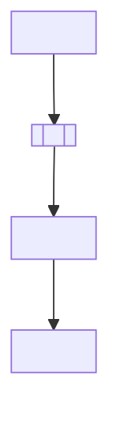
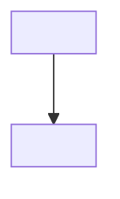
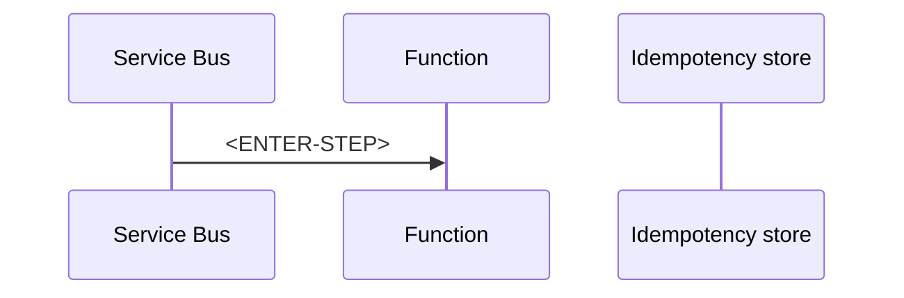

# AP-002: Duplicate Message Processing

> **Category:** Architecture Problem · **Difficulty:** Intermediate · **Status:** 📝 Draft note

<!-- Scenario seed: a Service Bus-triggered function processes payment or order messages. Occasionally the same business operation happens twice (e.g. a customer receives two emails or is credited twice). -->
<!-- Concepts likely relevant: at-least-once delivery, peek-lock, lock expiry, Service Bus duplicate detection (and its limits), idempotency keys, idempotency store, optimistic concurrency, outbox. -->

## 1. Problem title

<ENTER-TITLE>

## 2. Difficulty level

Intermediate — <ENTER-REASON>

## 3. Problem statement

<ENTER-PROBLEM>

## 4. Existing architecture



## 5. Symptoms

<!-- e.g. duplicate rows, duplicate emails, DeliveryCount > 1 in logs, lock-lost exceptions. -->

- <ENTER-SYMPTOM>

## 6. Functional requirements

- FR-1: <ENTER-REQUIREMENT>

## 7. Non-functional requirements

| ID | Requirement | Target |
| --- | --- | --- |
| NFR-1 | <ENTER-REQUIREMENT> | <ENTER-TARGET> |

## 8. Constraints

<!-- List only confirmed constraints, e.g. "the email provider has no idempotency key support". -->

- C-1: <ENTER-CONSTRAINT>

## 9. Assumptions

- A-1: <ENTER-ASSUMPTION>

## 10. Questions to consider

1. <ENTER-QUESTION — Where can duplicates originate: producer retries, redelivery after lock expiry, or both?>
2. <ENTER-QUESTION — Is the side effect naturally idempotent?>

## 11. Root-cause analysis

| Symptom | Underlying cause | Evidence |
| --- | --- | --- |
| <ENTER-SYMPTOM> | <ENTER-CAUSE> | <ENTER-EVIDENCE> |

## 12. Recommended architecture

<ENTER-SOLUTION>

## 13. Architecture diagram



## 14. Component responsibilities

| Component | Responsibility | Why it is required |
| --- | --- | --- |
| <ENTER-COMPONENT> | <ENTER-RESPONSIBILITY> | <ENTER-JUSTIFICATION> |

## 15. End-to-end request or event flow



## 16. C# implementation approach

<!-- Show an idempotent handler: check-then-act with a conditional insert (unique key) rather than a read-then-write race. -->

**<ENTER-EXAMPLE-LABEL>**

```csharp
// <ENTER-CODE>
```

## 17. Configuration examples

```json
{
  "<ENTER-SETTING>": "<YOUR-APPLICATION-SETTING>"
}
```

## 18. Security considerations

- <ENTER-SECURITY-CONSIDERATION>

## 19. Scalability considerations

- <ENTER-SCALABILITY-CONSIDERATION — cost of an extra store lookup per message>

## 20. Reliability considerations

- <ENTER-RELIABILITY-CONSIDERATION>

## 21. Observability and monitoring

| Signal | Source | Alert condition |
| --- | --- | --- |
| <ENTER-SIGNAL — duplicates skipped count> | <ENTER-SOURCE> | <ENTER-CONDITION> |

## 22. Failure scenarios

| Failure | Impact | Detection | Handling |
| --- | --- | --- | --- |
| <ENTER-FAILURE> | <ENTER-IMPACT> | <ENTER-DETECTION> | <ENTER-HANDLING> |

## 23. Retry and recovery strategy

<ENTER-RETRY-STRATEGY>

## 24. Trade-offs

| Decision | Benefit | Cost |
| --- | --- | --- |
| <ENTER-DECISION> | <ENTER-BENEFIT> | <ENTER-COST> |

## 25. Alternative solutions

| Alternative | When it fits | Why not chosen here |
| --- | --- | --- |
| <ENTER-ALTERNATIVE — rely only on Service Bus duplicate detection> | <ENTER-FIT> | <ENTER-REASON> |

## 26. Why the recommended solution is preferred

<ENTER-JUSTIFICATION>

## 27. Production-readiness checklist

- [ ] <ENTER-CHECK>

## 28. Follow-up questions

1. <ENTER-FOLLOW-UP-QUESTION>

## 29. Quick revision summary

📌 <ENTER-SUMMARY>

---

[⬅️ Previous: AP-001 Downstream API Throttling](AP-001-Downstream-API-Throttling.md) · [Index](index.md) · [Next: AP-003 Long-Running Operation ➡️](AP-003-Long-Running-Operation.md)
