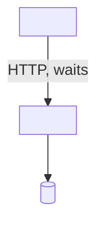
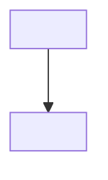
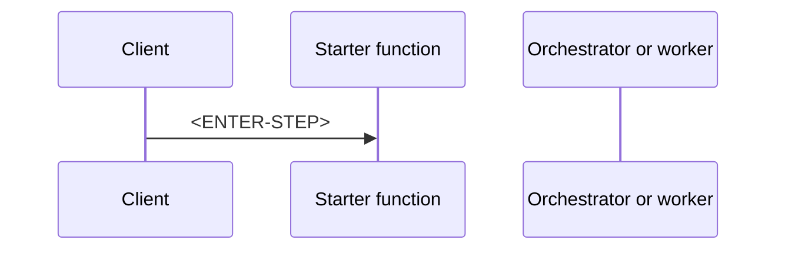

# AP-003: Long-Running Operation

> **Category:** Architecture Problem · **Difficulty:** Intermediate · **Status:** 📝 Draft note

> ⚠️ Execution time limits differ by hosting plan and trigger type (HTTP requests have their own gateway timeout). Verify current limits against official documentation.

<!-- Scenario seed: an HTTP-triggered function generates a large report or runs a multi-step import that sometimes takes several minutes. Clients receive timeouts and work is sometimes left half-finished. -->
<!-- Concepts likely relevant: function timeout, HTTP timeout, asynchronous request-reply (202 + status), queue hand-off, Durable Functions, checkpointing, cancellation tokens. -->

## 1. Problem title

<ENTER-TITLE>

## 2. Difficulty level

Intermediate — <ENTER-REASON>

## 3. Problem statement

<ENTER-PROBLEM>

## 4. Existing architecture



## 5. Symptoms

<!-- e.g. clients see HTTP timeout, function logs "Timeout value exceeded", partial output files. -->

- <ENTER-SYMPTOM>

## 6. Functional requirements

- FR-1: <ENTER-REQUIREMENT>

## 7. Non-functional requirements

| ID | Requirement | Target |
| --- | --- | --- |
| NFR-1 | <ENTER-REQUIREMENT> | <ENTER-TARGET> |

## 8. Constraints

- C-1: <ENTER-CONSTRAINT — current hosting plan>

## 9. Assumptions

- A-1: <ENTER-ASSUMPTION>

## 10. Questions to consider

1. <ENTER-QUESTION — Can the work be split into smaller resumable steps?>
2. <ENTER-QUESTION — Does the client need progress updates?>

## 11. Root-cause analysis

| Symptom | Underlying cause | Evidence |
| --- | --- | --- |
| <ENTER-SYMPTOM> | <ENTER-CAUSE> | <ENTER-EVIDENCE> |

## 12. Recommended architecture

<ENTER-SOLUTION>

## 13. Architecture diagram



## 14. Component responsibilities

| Component | Responsibility | Why it is required |
| --- | --- | --- |
| <ENTER-COMPONENT> | <ENTER-RESPONSIBILITY> | <ENTER-JUSTIFICATION> |

## 15. End-to-end request or event flow



## 16. C# implementation approach

<!-- Compare: (a) queue hand-off with a worker function, (b) Durable Functions orchestration with activity functions. Label each example. -->

**<ENTER-EXAMPLE-LABEL>**

```csharp
// <ENTER-CODE>
```

## 17. Configuration examples

```json
{
  "version": "2.0",
  "functionTimeout": "<ENTER-VALUE>"
}
```

## 18. Security considerations

- <ENTER-SECURITY-CONSIDERATION — protect the status endpoint so users only see their own jobs>

## 19. Scalability considerations

- <ENTER-SCALABILITY-CONSIDERATION>

## 20. Reliability considerations

- <ENTER-RELIABILITY-CONSIDERATION — what happens if an instance is recycled mid-job?>

## 21. Observability and monitoring

| Signal | Source | Alert condition |
| --- | --- | --- |
| <ENTER-SIGNAL> | <ENTER-SOURCE> | <ENTER-CONDITION> |

## 22. Failure scenarios

| Failure | Impact | Detection | Handling |
| --- | --- | --- | --- |
| <ENTER-FAILURE> | <ENTER-IMPACT> | <ENTER-DETECTION> | <ENTER-HANDLING> |

## 23. Retry and recovery strategy

<ENTER-RETRY-STRATEGY>

## 24. Trade-offs

| Decision | Benefit | Cost |
| --- | --- | --- |
| <ENTER-DECISION> | <ENTER-BENEFIT> | <ENTER-COST> |

## 25. Alternative solutions

| Alternative | When it fits | Why not chosen here |
| --- | --- | --- |
| <ENTER-ALTERNATIVE — Container Apps job / Azure Batch> | <ENTER-FIT> | <ENTER-REASON> |

## 26. Why the recommended solution is preferred

<ENTER-JUSTIFICATION>

## 27. Production-readiness checklist

- [ ] <ENTER-CHECK>

## 28. Follow-up questions

1. <ENTER-FOLLOW-UP-QUESTION>

## 29. Quick revision summary

📌 <ENTER-SUMMARY>

---

[⬅️ Previous: AP-002 Duplicate Message Processing](AP-002-Duplicate-Message-Processing.md) · [Index](index.md) · [Next: AP-004 High-Traffic HTTP Function ➡️](AP-004-High-Traffic-HTTP-Function.md)
