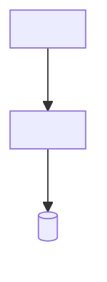
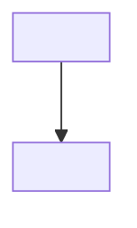
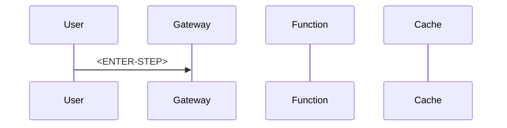

# AP-004: High-Traffic HTTP Function

> **Category:** Architecture Problem · **Difficulty:** Advanced · **Status:** 📝 Draft note

<!-- Scenario seed: a public read-heavy HTTP API (e.g. product price lookup) served by Azure Functions sees latency spikes and cold starts during traffic peaks; the backing database becomes a bottleneck. -->
<!-- Concepts likely relevant: hosting plan choice, cold start, pre-warmed / always-ready instances, caching (in-memory vs Redis vs APIM cache), connection reuse (HttpClientFactory, singleton SDK clients), APIM rate limiting, CDN/Front Door, database connection limits. -->

## 1. Problem title

<ENTER-TITLE>

## 2. Difficulty level

Advanced — <ENTER-REASON>

## 3. Problem statement

<ENTER-PROBLEM>

## 4. Existing architecture



## 5. Symptoms

<!-- e.g. p95 latency spikes after idle periods, SNAT port exhaustion, database connection-limit errors. -->

- <ENTER-SYMPTOM>

## 6. Functional requirements

- FR-1: <ENTER-REQUIREMENT>

## 7. Non-functional requirements

| ID | Requirement | Target |
| --- | --- | --- |
| NFR-1 | <ENTER-REQUIREMENT — p95 latency> | <ENTER-TARGET> |

## 8. Constraints

- C-1: <ENTER-CONSTRAINT>

## 9. Assumptions

- A-1: <ENTER-ASSUMPTION — acceptable data staleness for cached responses>

## 10. Questions to consider

1. <ENTER-QUESTION — What is the read/write ratio and acceptable staleness?>
2. <ENTER-QUESTION — Is the latency caused by cold start, dependency calls, or both?>

## 11. Root-cause analysis

| Symptom | Underlying cause | Evidence |
| --- | --- | --- |
| <ENTER-SYMPTOM> | <ENTER-CAUSE> | <ENTER-EVIDENCE> |

## 12. Recommended architecture

<ENTER-SOLUTION>

## 13. Architecture diagram



## 14. Component responsibilities

| Component | Responsibility | Why it is required |
| --- | --- | --- |
| <ENTER-COMPONENT> | <ENTER-RESPONSIBILITY> | <ENTER-JUSTIFICATION> |

## 15. End-to-end request or event flow



## 16. C# implementation approach

<!-- Show cache-aside with IDistributedCache or HybridCache (verify availability), singleton clients, and CancellationToken propagation. -->

**<ENTER-EXAMPLE-LABEL>**

```csharp
// <ENTER-CODE>
```

## 17. Configuration examples

```json
{
  "<ENTER-SETTING>": "<YOUR-APPLICATION-SETTING>"
}
```

## 18. Security considerations

- <ENTER-SECURITY-CONSIDERATION>

## 19. Scalability considerations

- <ENTER-SCALABILITY-CONSIDERATION>

## 20. Reliability considerations

- <ENTER-RELIABILITY-CONSIDERATION — behaviour when the cache is unavailable>

## 21. Observability and monitoring

| Signal | Source | Alert condition |
| --- | --- | --- |
| <ENTER-SIGNAL — cache hit ratio> | <ENTER-SOURCE> | <ENTER-CONDITION> |

## 22. Failure scenarios

| Failure | Impact | Detection | Handling |
| --- | --- | --- | --- |
| <ENTER-FAILURE — cache stampede> | <ENTER-IMPACT> | <ENTER-DETECTION> | <ENTER-HANDLING> |

## 23. Retry and recovery strategy

<ENTER-RETRY-STRATEGY>

## 24. Trade-offs

| Decision | Benefit | Cost |
| --- | --- | --- |
| <ENTER-DECISION> | <ENTER-BENEFIT> | <ENTER-COST> |

## 25. Alternative solutions

| Alternative | When it fits | Why not chosen here |
| --- | --- | --- |
| <ENTER-ALTERNATIVE — App Service or Container Apps> | <ENTER-FIT> | <ENTER-REASON> |

## 26. Why the recommended solution is preferred

<ENTER-JUSTIFICATION>

## 27. Production-readiness checklist

- [ ] <ENTER-CHECK>

## 28. Follow-up questions

1. <ENTER-FOLLOW-UP-QUESTION>

## 29. Quick revision summary

📌 <ENTER-SUMMARY>

---

[⬅️ Previous: AP-003 Long-Running Operation](AP-003-Long-Running-Operation.md) · [Index](index.md) · [Next: AP-005 Secure Secretless Architecture ➡️](AP-005-Secure-Secretless-Architecture.md)
