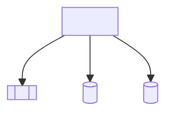
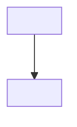
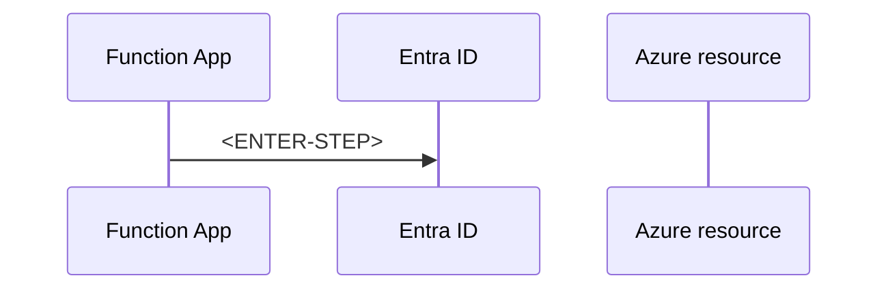

# AP-005: Secure Secretless Architecture

> **Category:** Architecture Problem · **Difficulty:** Intermediate · **Status:** 📝 Draft note

<!-- Scenario seed: a Function App uses connection strings and keys for Storage, Service Bus, SQL and a third-party API, stored in app settings. A security review requires removing stored secrets and restricting network access. -->
<!-- Concepts likely relevant: system vs user-assigned managed identity, identity-based trigger connections, AzureWebJobsStorage with identity, RBAC data-plane roles, Key Vault references for unavoidable secrets, private endpoints, VNet integration, disabling local/shared-key auth. -->

## 1. Problem title

<ENTER-TITLE>

## 2. Difficulty level

Intermediate — <ENTER-REASON>

## 3. Problem statement

<ENTER-PROBLEM>

## 4. Existing architecture



## 5. Symptoms

<!-- This problem is driven by audit findings rather than outages. List the findings. -->

- <ENTER-SYMPTOM — e.g. secrets visible in app settings to anyone with Contributor access>

## 6. Functional requirements

- FR-1: <ENTER-REQUIREMENT>

## 7. Non-functional requirements

| ID | Requirement | Target |
| --- | --- | --- |
| NFR-1 | <ENTER-REQUIREMENT> | <ENTER-TARGET> |

## 8. Constraints

- C-1: <ENTER-CONSTRAINT — third-party API only supports API keys>

## 9. Assumptions

- A-1: <ENTER-ASSUMPTION>

## 10. Questions to consider

1. <ENTER-QUESTION — System-assigned or user-assigned identity, and why?>
2. <ENTER-QUESTION — Which secrets cannot be eliminated and must be stored in Key Vault?>

## 11. Root-cause analysis

| Finding | Underlying cause | Evidence |
| --- | --- | --- |
| <ENTER-FINDING> | <ENTER-CAUSE> | <ENTER-EVIDENCE> |

## 12. Recommended architecture

<ENTER-SOLUTION>

## 13. Architecture diagram



## 14. Component responsibilities

| Component | Responsibility | Why it is required |
| --- | --- | --- |
| <ENTER-COMPONENT> | <ENTER-RESPONSIBILITY> | <ENTER-JUSTIFICATION> |

## 15. End-to-end request or event flow



## 16. C# implementation approach

**<ENTER-EXAMPLE-LABEL>**

```csharp
// <ENTER-CODE>
```

## 17. Configuration examples

<!-- Show identity-based connection settings (e.g. AzureWebJobsStorage__accountName, <Prefix>__fullyQualifiedNamespace) and a Key Vault reference. Verify setting names in official docs. -->

```json
{
  "<ENTER-SETTING>": "<YOUR-APPLICATION-SETTING>"
}
```

## 18. Security considerations

- <ENTER-SECURITY-CONSIDERATION>

## 19. Scalability considerations

- <ENTER-SCALABILITY-CONSIDERATION>

## 20. Reliability considerations

- <ENTER-RELIABILITY-CONSIDERATION — role-assignment propagation delay during deployment>

## 21. Observability and monitoring

| Signal | Source | Alert condition |
| --- | --- | --- |
| <ENTER-SIGNAL — 401/403 on dependencies> | <ENTER-SOURCE> | <ENTER-CONDITION> |

## 22. Failure scenarios

| Failure | Impact | Detection | Handling |
| --- | --- | --- | --- |
| <ENTER-FAILURE> | <ENTER-IMPACT> | <ENTER-DETECTION> | <ENTER-HANDLING> |

## 23. Retry and recovery strategy

<ENTER-RETRY-STRATEGY>

## 24. Trade-offs

| Decision | Benefit | Cost |
| --- | --- | --- |
| <ENTER-DECISION> | <ENTER-BENEFIT> | <ENTER-COST> |

## 25. Alternative solutions

| Alternative | When it fits | Why not chosen here |
| --- | --- | --- |
| <ENTER-ALTERNATIVE> | <ENTER-FIT> | <ENTER-REASON> |

## 26. Why the recommended solution is preferred

<ENTER-JUSTIFICATION>

## 27. Production-readiness checklist

- [ ] <ENTER-CHECK>

## 28. Follow-up questions

1. <ENTER-FOLLOW-UP-QUESTION>

## 29. Quick revision summary

📌 <ENTER-SUMMARY>

---

[⬅️ Previous: AP-004 High-Traffic HTTP Function](AP-004-High-Traffic-HTTP-Function.md) · [Index](index.md) · [Next section: System Design ➡️](../04-System-Design/index.md)
