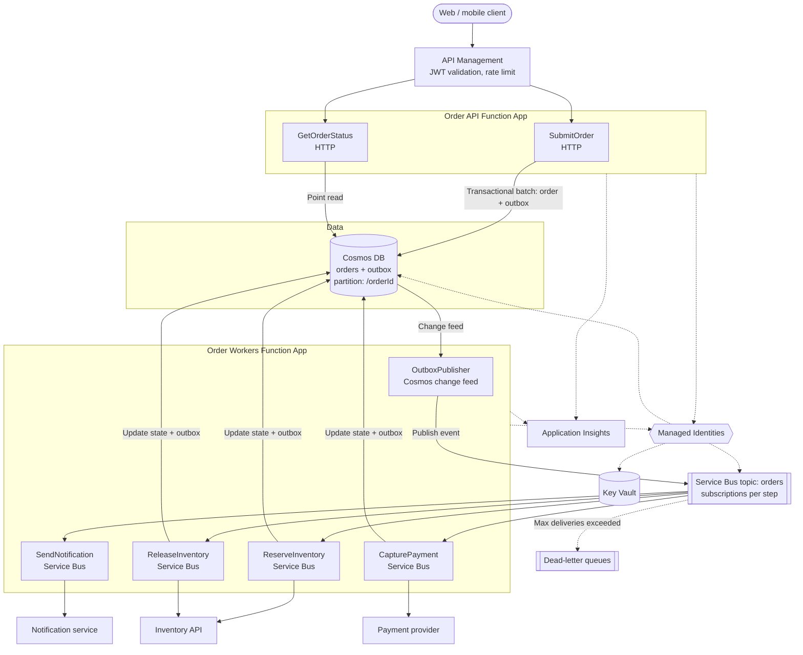
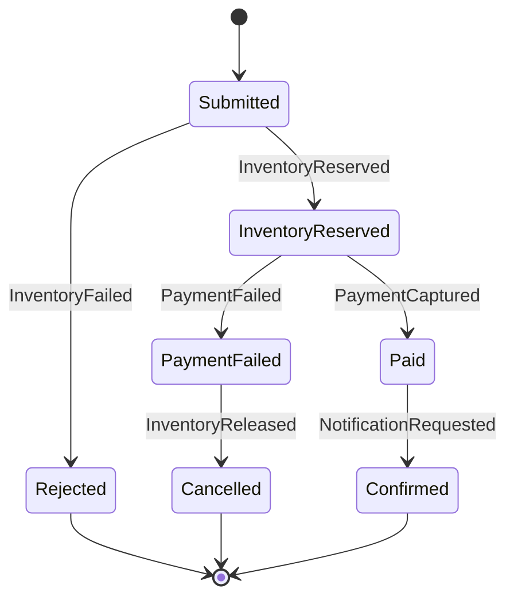
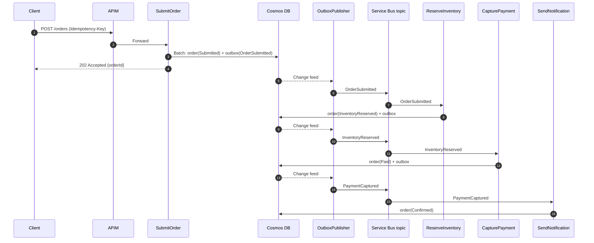

# SD-001: Order Processing System

> **Category:** System Design · **Status:** Complete sample note · **Applies to:** Azure Functions isolated worker (.NET 8+), Service Bus, Cosmos DB, API Management

> ⚠️ Throughput limits, pricing and feature availability depend on service tier, hosting plan and region. All numbers below are **assumptions** for design reasoning. Verify against current official documentation.

---

## 1. Design question

Design an order processing back end for an e-commerce platform. Customers submit orders through a web and mobile front end. Each order must be validated, have stock reserved, be paid for, and trigger a confirmation notification. Azure Function App must be used for the processing logic.

## 2. Business context

- A mid-sized online retailer is moving from a monolith to event-driven services.
- Order volume is normally moderate but spikes 10× during promotions.
- Lost or duplicated orders directly cost money and customer trust.
- Inventory and payment are handled by **existing services** (an internal inventory API and an external payment provider).

## 3. Scope

- Order submission API
- Order validation and persistence
- Orchestration of inventory reservation, payment and confirmation
- Order status queries
- Failure handling, retries and compensation (release stock on payment failure)
- Monitoring and alerting

## 4. Out-of-scope items

- Product catalogue and search
- Shopping cart
- Inventory service internals
- Payment provider internals (see [SD-002](SD-002-Payment-Processing-System.md))
- Shipping and fulfilment
- Notification delivery channels (see [SD-003](SD-003-Notification-System.md))

## 5. Functional requirements

- **FR-1:** A customer can submit an order and receive an order ID immediately.
- **FR-2:** The system validates the order (customer, items, quantities, prices).
- **FR-3:** Stock is reserved for each item.
- **FR-4:** Payment is captured once stock is reserved.
- **FR-5:** If payment fails, reserved stock is released (compensation).
- **FR-6:** The customer is notified when the order is confirmed or fails.
- **FR-7:** A customer can query order status.
- **FR-8:** Resubmitting the same order (same client order key) does not create a second order.

## 6. Non-functional requirements

| ID | Requirement | Target (assumed) |
| --- | --- | --- |
| NFR-1 | Order intake availability | 99.95% |
| NFR-2 | Intake latency (p95) | < 500 ms |
| NFR-3 | Order completion latency (p95) | < 30 s at normal load; < 5 min at peak |
| NFR-4 | Durability | Zero accepted orders lost |
| NFR-5 | Correctness | No duplicate charges; no duplicate orders |
| NFR-6 | Security | No secrets in code; least privilege; PII protected |
| NFR-7 | Observability | Every order traceable end-to-end by order ID |

## 7. Expected traffic and workload assumptions

| Metric | Assumed value |
| --- | --- |
| Average orders | 5 orders/second |
| Peak orders (promotions) | 50 orders/second for up to 1 hour |
| Status queries | ~10× order rate |
| Average order document size | 2–5 KB |
| Items per order | 1–20 |
| Payment provider limit | 30 requests/second |
| Inventory API latency (p95) | 200 ms |
| Data retention | Orders kept 7 years (compliance); operational events 30 days |

## 8. Major design challenges

1. **Bursty intake vs limited downstream capacity** (payment provider limit below peak order rate).
2. **Multi-step workflow** with a compensation path (reserve → pay → confirm, or release on failure).
3. **At-least-once messaging** means every step can run more than once — every step must be idempotent.
4. **Consistency** between the order record and the events that drive the workflow.
5. **Tracing** across HTTP, messaging and external calls.

## 9. High-level architecture

🧩 The recommended design is an **event-driven pipeline** with a **Service Bus–based workflow**:

- **API Management** fronts the order API.
- An **Order API Function App** accepts orders, writes them to **Cosmos DB**, and publishes an `OrderSubmitted` event.
- To avoid a "write succeeded but publish failed" gap, the order document and an **outbox** entry are written in the **same Cosmos DB transactional batch** (same partition key). A **Cosmos DB change feed–triggered function** publishes outbox entries to Service Bus.
- A **Service Bus topic** (`orders`) with subscriptions drives separate **worker functions** for inventory, payment and notification.
- Each worker updates the order state in Cosmos DB and publishes the next event.
- Failures go to **dead-letter queues**; compensation events release stock on payment failure.

> 💡 An alternative is **Durable Functions** orchestration for the workflow. See [section 27](#27-alternative-architecture) for why it was not the primary choice under these assumptions.

## 10. Architecture diagram



## 11. Component selection

| Need | Selected component | Considered alternatives | Reason |
| --- | --- | --- | --- |
| Public API gateway | API Management | Front Door only, direct Function access | Auth, rate limiting, versioning, policy-based validation |
| Compute | Azure Functions (isolated worker) | Container Apps, App Service | Event-driven triggers; scales per load; team familiarity |
| Order store | Cosmos DB (NoSQL API) | Azure SQL | Partitioned writes at peak; document model fits orders; change feed supports outbox |
| Messaging | Service Bus topic + subscriptions | Event Grid, Storage queues, Event Hubs | Ordered delivery options, DLQ, duplicate detection, peek-lock |
| Secrets | Key Vault | App settings | Central rotation; payment provider credentials |
| Identity | Managed Identity | Connection strings | No stored credentials for Azure resources |
| Monitoring | Application Insights | Third-party APM | Native integration with Functions and distributed tracing |

## 12. Component responsibility

| Component | Responsibility |
| --- | --- |
| API Management | Validate JWT, enforce per-client rate limits, route to Order API, add correlation ID |
| SubmitOrder | Validate request, enforce idempotency on client order key, write order + outbox in one batch, return 202 |
| GetOrderStatus | Point-read order by ID and return status |
| OutboxPublisher | Read outbox entries from change feed, publish to Service Bus with `MessageId` = event ID, mark entry published |
| ReserveInventory | Reserve stock; emit `InventoryReserved` or `InventoryFailed` |
| CapturePayment | Capture payment with idempotency key; emit `PaymentCaptured` or `PaymentFailed`; concurrency capped to stay under provider limit |
| ReleaseInventory | On `PaymentFailed`, release reserved stock; emit `InventoryReleased` |
| SendNotification | On terminal events, request customer notification |
| Cosmos DB | System of record for order state and outbox |
| Service Bus | Durable event delivery, retries, dead-lettering |

## 13. Data flow

1. Client sends `POST /orders` with `Idempotency-Key` header.
2. APIM validates the token and rate limit; forwards to `SubmitOrder`.
3. `SubmitOrder` validates and writes **order** (`status = Submitted`) and **outbox** (`OrderSubmitted`) in a transactional batch.
4. Returns **202 Accepted** with `orderId` and status URL.
5. Change feed triggers `OutboxPublisher`, which publishes `OrderSubmitted` to the topic.
6. `ReserveInventory` reserves stock; writes `status = InventoryReserved` + outbox `InventoryReserved`.
7. `CapturePayment` captures payment; writes `status = Paid` + outbox `PaymentCaptured`.
8. `SendNotification` sends confirmation; order `status = Confirmed`.
9. On `PaymentFailed`: `ReleaseInventory` releases stock → `status = Cancelled` → notification.

## 14. API or event flow

### Order state machine



### Happy-path sequence



### API contract (simplified)

```http
POST /orders
Idempotency-Key: 6f1c...       (client-generated GUID)
Content-Type: application/json

{ "customerId": "c-123", "items": [ { "sku": "SKU-1", "quantity": 2 } ] }

HTTP/1.1 202 Accepted
Location: /orders/ord-789
{ "orderId": "ord-789", "status": "Submitted" }
```

## 15. Data storage strategy

| Data | Store | Partition key | Notes |
| --- | --- | --- | --- |
| Order document | Cosmos DB `orders` container | `/orderId` | Status, items, totals, timestamps, `_etag` for optimistic concurrency |
| Outbox entries | Same container (type = `outbox`) | `/orderId` | Same partition allows a transactional batch with the order |
| Idempotency mapping (client key → orderId) | Same container (type = `idempotency`) | `/orderId` *or* a separate container keyed by client key | Unique key per client key; TTL after retention window |
| Processed-event markers | Within the order document (`processedEvents[]`) | `/orderId` | Allows each worker to skip already-applied events |
| Archive | Cosmos DB analytical store or export to Storage | — | Long-term retention and reporting |

💡 **Why the same partition?** Cosmos DB transactional batches are limited to a single logical partition. Placing the order and its outbox entries in the same partition gives atomic "state change + event" writes.

> ⚠️ Looking up an order by **client idempotency key** needs either a separate container partitioned by that key, or a deterministic order ID derived from it. Choose one and document it. This design derives `orderId` deterministically from `(customerId, Idempotency-Key)`, so a duplicate submission maps to the same document and the create fails with a conflict (409), which is then treated as success.

## 16. Security design

- **Edge:** APIM validates Entra ID or B2C tokens; WAF (Front Door or Application Gateway) optional for public exposure.
- **Function access:** functions accept traffic only from APIM (access restrictions or private endpoint plus function keys as defence in depth).
- **Data:** Cosmos DB with RBAC data-plane access; local key auth disabled where supported.
- **Secrets:** payment provider credentials in Key Vault; referenced via Key Vault references.
- **PII:** customer data minimised in events (send IDs, not full addresses); logs scrubbed.
- **Network:** private endpoints for Cosmos DB, Service Bus and Key Vault with VNet-integrated Function Apps (hosting-plan dependent).

## 17. Identity and access

| Caller | Target | Identity | Role / permission (verify names) |
| --- | --- | --- | --- |
| Order API Function App | Cosmos DB | System-assigned MI | Cosmos DB Built-in Data Contributor (scoped to database) |
| Workers Function App | Cosmos DB | System-assigned MI | Cosmos DB Built-in Data Contributor |
| Workers Function App | Service Bus topic | System-assigned MI | Azure Service Bus Data Sender + Data Receiver (scoped to topic) |
| Workers Function App | Key Vault | System-assigned MI | Key Vault Secrets User |
| Both apps | Storage (`AzureWebJobsStorage`) | System-assigned MI | Storage Blob Data Owner (and Queue/Table roles as required by triggers) |
| APIM | Order API | Managed identity or function key | Function access restriction |

## 18. Scaling strategy

- **Order API app:** scales with HTTP load; intake is cheap (one batch write).
- **Workers app:** separate Function App so worker scale limits are independent of intake.
- **CapturePayment:** concurrency capped (`maxConcurrentCalls` × max instances) so the rate stays below 30 req/s. During peaks, the payment subscription backlog grows and drains afterwards.
- **Cosmos DB:** autoscale throughput sized for peak write RU/s; `/orderId` gives even distribution.
- **Service Bus:** Standard tier may be enough at this volume; Premium if network isolation or predictable throughput is required.

**Back-of-envelope (assumed):** 50 orders/s × ~6 writes per order lifecycle ≈ 300 writes/s peak. RU cost per write depends on document size and indexing. Measure with real documents.

## 19. Resilience strategy

| Concern | Strategy |
| --- | --- |
| Transient failures calling inventory/payment | `Microsoft.Extensions.Http.Resilience`: timeout, retry with exponential backoff + jitter, circuit breaker |
| Poison messages | `MaxDeliveryCount` then DLQ with reason |
| Payment provider throttling | Concurrency cap + honour `Retry-After` |
| Cosmos DB 429 (RU exhaustion) | SDK built-in retry; autoscale; alert on throttled requests |
| Partial workflow failure | State machine + compensation (`ReleaseInventory`) |
| Instance crash mid-step | Peek-lock redelivery + idempotent handlers |

## 20. Idempotency strategy

| Step | Idempotency key | Mechanism |
| --- | --- | --- |
| Order submission | `(customerId, Idempotency-Key)` → deterministic `orderId` | Create-if-not-exists; 409 treated as success and existing order returned |
| Outbox publish | Outbox entry ID → `MessageId` | Service Bus duplicate detection; entry marked published |
| Each worker step | `eventId` | Worker checks `processedEvents[]` on the order before acting; updates with `_etag` precondition |
| Inventory reservation | `orderId` | Inventory API reserve-by-order-ID (assumed supported) |
| Payment capture | `orderId` | Payment provider idempotency key header (assumed supported; confirm with provider) |

**Simplified example** — idempotent worker step with optimistic concurrency:

```csharp
using System.Net;
using Azure.Messaging.ServiceBus;
using Microsoft.Azure.Cosmos;
using Microsoft.Azure.Functions.Worker;
using Microsoft.Extensions.Logging;

public sealed class ReserveInventoryFunction
{
    private readonly Container _orders;
    private readonly IInventoryClient _inventory;
    private readonly ILogger<ReserveInventoryFunction> _logger;

    public ReserveInventoryFunction(CosmosClient cosmos, IInventoryClient inventory, ILogger<ReserveInventoryFunction> logger)
    {
        _orders = cosmos.GetContainer("<YOUR-DATABASE>", "orders");
        _inventory = inventory;
        _logger = logger;
    }

    [Function("ReserveInventory")]
    public async Task Run(
        [ServiceBusTrigger("orders", "reserve-inventory", Connection = "ServiceBusConnection")]
        ServiceBusReceivedMessage message,
        CancellationToken cancellationToken)
    {
        var evt = message.Body.ToObjectFromJson<OrderEvent>()!;
        using var _ = _logger.BeginScope(new Dictionary<string, object>
        {
            ["OrderId"] = evt.OrderId,
            ["EventId"] = evt.EventId,
            ["CorrelationId"] = message.CorrelationId ?? string.Empty
        });

        ItemResponse<OrderDocument> read = await _orders.ReadItemAsync<OrderDocument>(
            evt.OrderId, new PartitionKey(evt.OrderId), cancellationToken: cancellationToken);
        OrderDocument order = read.Resource;

        if (order.ProcessedEvents.Contains(evt.EventId))
        {
            _logger.LogInformation("Event already applied; skipping");
            return; // Message auto-completes on success.
        }

        bool reserved = await _inventory.ReserveAsync(order.OrderId, order.Items, cancellationToken);

        order.Status = reserved ? "InventoryReserved" : "Rejected";
        order.ProcessedEvents.Add(evt.EventId);

        var outbox = OutboxEntry.For(order, reserved ? "InventoryReserved" : "InventoryFailed");

        TransactionalBatchResponse batch = await _orders.CreateTransactionalBatch(new PartitionKey(order.OrderId))
            .ReplaceItem(order.Id, order, new TransactionalBatchItemRequestOptions { IfMatchEtag = read.ETag })
            .CreateItem(outbox)
            .ExecuteAsync(cancellationToken);

        if (batch.StatusCode == HttpStatusCode.PreconditionFailed)
        {
            // Another instance updated the order concurrently; throw so Service Bus redelivers.
            throw new InvalidOperationException("Concurrent update detected; will retry.");
        }

        if (!batch.IsSuccessStatusCode)
        {
            throw new InvalidOperationException($"Batch failed with {batch.StatusCode}.");
        }
    }
}
```

> 💡 The inventory call happens **before** the state write. If the function crashes between the two, the event is redelivered and the inventory call is repeated — so the inventory API **must** be idempotent per `orderId`. This dependency is listed as an assumption.

## 21. Retry and dead-letter handling

| Layer | Retry | Dead-letter |
| --- | --- | --- |
| HTTP client calls | 3 attempts, exponential backoff + jitter, per-attempt timeout | — |
| Service Bus delivery | Redelivery up to `MaxDeliveryCount` (for example 10) | Automatic DLQ after limit |
| Business rule failure (e.g. invalid SKU) | No retry | Emit failure event (not DLQ) — it is an expected outcome |
| DLQ processing | Operator-triggered replay function after fix | Alert on any DLQ message |

## 22. Monitoring and observability

| Signal | Source | Alert condition (example) |
| --- | --- | --- |
| Intake 5xx rate | Application Insights requests | > 1% for 5 min |
| Intake latency p95 | Application Insights requests | > 500 ms for 10 min |
| Orders stuck in non-terminal state | Scheduled query on Cosmos DB / custom metric | Any order not terminal after 15 min |
| Subscription backlog | Service Bus active messages | Growing for > 15 min |
| DLQ count | Service Bus dead-letter messages | > 0 |
| Payment 429 / failures | Dependencies | > 2% for 5 min |
| Cosmos DB throttling (429) | Cosmos DB metrics | Sustained > 0 |
| Change feed lag | Custom metric (now − last processed `_ts`) | > 60 s |

**Correlation:** `orderId` and `correlationId` are added as log scope properties and as Service Bus message properties so all telemetry for one order can be queried together:

```kusto
union traces, requests, dependencies, exceptions
| where timestamp > ago(1d)
| where customDimensions.OrderId == "<ORDER-ID>"
| project timestamp, itemType, operation_Name, message, resultCode, customDimensions
| order by timestamp asc
```

## 23. Deployment approach

- **Infrastructure as Code** (Bicep or Terraform) for all resources, identities and role assignments.
- **Two Function Apps** (Order API, Workers) deployed independently through CI/CD pipelines.
- **Deployment slots** (where supported by the plan) for zero-downtime swaps of the Order API.
- **Configuration** via app settings and Key Vault references; no environment-specific values in code.
- **Schema/versioned events:** include `eventType` and `schemaVersion` so workers tolerate older and newer events during rolling deployments.
- **Feature flags** for risky workflow changes.

## 24. Disaster recovery considerations

| Aspect | Approach (assumed targets: RPO ≤ 5 min, RTO ≤ 1 h) |
| --- | --- |
| Cosmos DB | Multi-region replication with automatic failover (cost trade-off) |
| Service Bus | Premium tier geo-disaster recovery (metadata) or geo-replication — verify current capabilities; in-flight messages may not be replicated |
| Function Apps | Deployable to a secondary region from IaC; consider active-passive |
| APIM | Multi-region deployment (Premium tier) or redeploy from IaC |
| Runbook | Documented failover order, DNS/Front Door switch, replay of outbox entries not yet published |

> ⚠️ After failover, workers may reprocess events. The idempotency design is what makes this safe.

## 25. Cost considerations

- **Cosmos DB** is usually the largest cost driver — tune indexing policy, document size and autoscale maximum.
- **Function Apps:** consumption-style plans are cost-effective at variable load; Premium adds cost but removes cold start and enables VNet features (plan-dependent).
- **Service Bus Premium** is significantly more expensive than Standard; choose based on isolation and throughput needs.
- **APIM** tier selection affects cost strongly; a lower tier may be enough without multi-region needs.
- **Application Insights:** use sampling and retention settings to control ingestion cost.

## 26. Technical trade-offs

| Decision | Benefit | Cost |
| --- | --- | --- |
| Asynchronous 202 intake | High availability and low latency under spikes | Clients must poll or subscribe for status |
| Outbox via change feed | Atomic state + event; no lost events | Added latency (change feed lag), extra component |
| Choreography via topic | Loosely coupled steps; independent scaling | Workflow logic spread across functions; harder to visualise |
| Cosmos DB | Elastic scale, change feed | RU cost model; partition design is critical |
| Separate worker app | Independent scale limits | More resources to manage |

## 27. Alternative architecture

**Durable Functions orchestration:**

- An orchestrator function calls activities: `ReserveInventory` → `CapturePayment` → `SendNotification`, with compensation in `try/catch`.
- **Pros:** workflow is explicit in one place; built-in retry policies per activity; easy to visualise.
- **Cons:** orchestrator code must be deterministic; versioning long-running orchestrations needs care; storage provider throughput must be sized; team must learn the replay model.
- **When to prefer it:** when the workflow is complex (many branches, timeouts, human approval) and visibility of the orchestration matters more than loose coupling.

**Azure SQL instead of Cosmos DB:**

- **Pros:** relational integrity; outbox in the same transaction as order rows; familiar tooling.
- **Cons:** scaling writes at peak may require higher tiers; change data capture is a different publishing mechanism.

## 28. Failure-mode analysis

| Component failure | Impact | Detection | Mitigation |
| --- | --- | --- | --- |
| APIM unavailable | No new orders | Availability tests | Multi-region APIM or failover path |
| Order API Function App fails to start | No new orders | Availability test, 5xx alert | Slot swap rollback; startup validation |
| Cosmos DB throttling | Intake slow or failing | Cosmos DB 429 metric | Autoscale; SDK retry; reduce RU per write |
| Change feed publisher stalled | Orders stuck in `Submitted` | Change feed lag alert | Restart; investigate lease container; replay |
| Service Bus outage | Workflow paused | Service Bus metrics, publisher errors | Outbox retains events; publish resumes after recovery |
| Inventory API down | Orders stuck at `Submitted` | Circuit breaker events | Retry/redeliver; DLQ after limit; alert |
| Payment provider throttling | Payment backlog | 429 metrics, backlog growth | Concurrency cap; honour Retry-After |
| Payment captured but state write fails | Risk of double charge on retry | Delivery count > 1 | Provider idempotency key on `orderId` |
| Poison event (bad schema) | One order stuck | DLQ alert | Fix and replay; schema versioning |

## 29. Production-readiness checklist

- [ ] Idempotency confirmed for inventory and payment APIs (contractual, not assumed).
- [ ] Cosmos DB partition key, indexing policy and autoscale limits load-tested.
- [ ] Outbox publisher lease container and change feed lag monitoring in place.
- [ ] Service Bus subscriptions: lock duration, max delivery count, DLQ, duplicate detection configured.
- [ ] Payment worker concurrency validated against the provider limit.
- [ ] Compensation path (`PaymentFailed` → `ReleaseInventory`) tested end to end.
- [ ] "Stuck order" detector and alert in place.
- [ ] All identities use least-privilege data-plane roles; no connection strings.
- [ ] PII review of events and logs completed.
- [ ] DR runbook written and exercised.
- [ ] Dashboards for order funnel (submitted → confirmed) and failure reasons.
- [ ] Event schema versioning strategy documented.

## 30. Interview-style follow-up questions

1. Why not publish to Service Bus directly from `SubmitOrder` after writing to Cosmos DB? What failure does the outbox prevent?
2. How would you guarantee **per-customer ordering** of events if it became a requirement? (Hint: Service Bus sessions.)
3. How do you detect and recover an order that is stuck in `InventoryReserved` for an hour?
4. When would you switch from choreography to Durable Functions orchestration?
5. The payment provider does **not** support idempotency keys. How do you prevent double charges?
6. How would you support order **cancellation** by the customer while the workflow is running?
7. How would you change the design for **10×** the current peak?
8. What happens to in-flight messages during a regional failover, and how does the design tolerate it?

---

[Index](index.md) · [Next: SD-002 Payment Processing System ➡️](SD-002-Payment-Processing-System.md)
