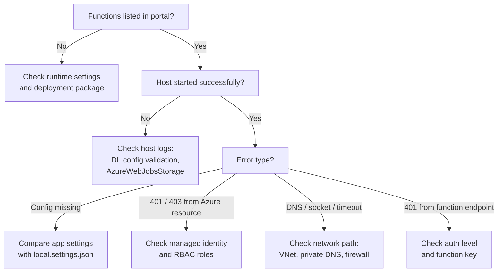

# PS-001: It Works Locally but Fails After Azure Deployment

> **Category:** Production Scenario · **Severity:** High · **Status:** Complete sample note · **Applies to:** Azure Functions isolated worker (.NET 8+)

---

## 1. Symptom

A Function App works correctly on a developer machine with `func start` or Visual Studio. After deployment to Azure, one or more of the following happens:

- Functions do not appear in the portal function list.
- HTTP calls return **500**, **401**, **403** or **404**.
- Triggers never fire (queue messages accumulate).
- Application Insights shows exceptions such as:
  - `InvalidOperationException: ... is not configured`
  - `Azure.Identity.CredentialUnavailableException` or `AuthenticationFailedException`
  - `Azure.RequestFailedException: Status: 403 (Forbidden)`
  - `System.Net.Sockets.SocketException` / `HttpRequestException: Name or service not known`
  - `Microsoft.Azure.Functions.Worker: Failed to start worker` or a host startup error

## 2. Impact

- The new release is unavailable or partially working.
- Messages may accumulate in queues and later cause a processing burst.
- Rollback may be needed, delaying the release.

## 3. Possible causes

| # | Possible cause | How to confirm or rule out |
| --- | --- | --- |
| 1 | **App settings missing** — values existed only in `local.settings.json` | Compare `Values` in `local.settings.json` with Function App **Environment variables** |
| 2 | **Wrong setting name format** — `:` used instead of `__` for nested keys on Linux | Inspect setting names; Linux does not support `:` in environment variable names |
| 3 | **Identity difference** — local developer identity had RBAC; the managed identity does not | Check managed identity is enabled and has role assignments on target resources |
| 4 | **User-assigned identity not selected** | `AZURE_CLIENT_ID` / `<Prefix>__clientId` missing; multiple identities attached |
| 5 | **Network restrictions** — target resource blocks public access; Function App lacks VNet integration or private DNS | Test from **Kudu/SSH console** or network troubleshooter; check resource firewall |
| 6 | **Runtime mismatch** — `FUNCTIONS_WORKER_RUNTIME` not `dotnet-isolated`, wrong .NET version on the app | Check app settings and platform configuration |
| 7 | **`FUNCTIONS_EXTENSION_VERSION` wrong** | Should be `~4` for current .NET isolated apps (verify) |
| 8 | **Deployment package issue** — missing `functions.metadata`, wrong build output, run-from-package problems | Inspect deployed files in Kudu; check deployment logs |
| 9 | **Key Vault reference not resolving** | Environment variables blade shows reference status; identity lacks *Key Vault Secrets User* |
| 10 | **`AzureWebJobsStorage` unreachable or misconfigured** | Host cannot start; errors in host logs; check storage firewall and identity roles |
| 11 | **HTTP auth level** — `AuthorizationLevel.Function` enforced in Azure but not locally | 401 without `code` query parameter or `x-functions-key` header |
| 12 | **DI registration only in development** — e.g. inside `if (IsDevelopment())` | Review `Program.cs` |

## 4. Most likely cause

In practice, the most frequent causes are **(1) missing app settings** and **(3) identity/RBAC differences**, often together.

**Why:** `local.settings.json` is **never deployed**, and `DefaultAzureCredential` authenticates as **the developer** locally but as **the managed identity** in Azure. Both differences are invisible during local testing.

> 💡 Treat "works locally, fails in Azure" as a **difference-finding exercise**: configuration, identity, network, runtime and package. Check them in that order — it goes from cheapest to most expensive to verify.

## 5. Diagnostic steps



1. 🔍 **Check the function list** in the portal. If it is empty, the problem is runtime or deployment, not your code.
2. 🔍 **Open Log stream** or Application Insights **traces** and look at host startup messages.
3. 🔍 **Compare configuration**:

    ```powershell
    # List app setting names (values are hidden here deliberately)
    az functionapp config appsettings list `
      --name <YOUR-FUNCTION-APP> --resource-group <YOUR-RESOURCE-GROUP> `
      --query "[].name" -o tsv
    ```

    Compare against the keys in your local `local.settings.json` `Values` section.

4. 🔍 **Check identity**:

    ```bash
    az functionapp identity show --name <YOUR-FUNCTION-APP> --resource-group <YOUR-RESOURCE-GROUP>
    az role assignment list --assignee <PRINCIPAL-ID> --all -o table
    ```

5. 🔍 **Check network** from inside the app (Kudu console on Windows or SSH on Linux, where available):

    ```bash
    nslookup <YOUR-KEY-VAULT-NAME>.vault.azure.net
    # A private IP (e.g. 10.x.x.x) indicates private endpoint DNS is working.
    ```

6. 🔍 **Check runtime settings**: `FUNCTIONS_WORKER_RUNTIME`, `FUNCTIONS_EXTENSION_VERSION` and the configured .NET version.
7. 🔍 **Check Key Vault references** on the Environment variables blade — each reference shows a resolution status.
8. 🔍 **Reproduce with the failing identity**, if possible, by running locally with the same identity type (for example a dedicated test service principal) against the same resources.

## 6. Logs and metrics to inspect

| Source | What to look for |
| --- | --- |
| Log stream | Host startup errors, worker process start failures |
| Application Insights → Failures | Exception type and message; dependency failures with 401/403 |
| Application Insights → traces | `Host started`, `Worker process started`, configuration validation messages |
| Function App → Diagnose and solve problems | Built-in detectors for function app down, configuration and networking |
| Function App → Environment variables | Key Vault reference status |
| Target resource → Access control (IAM) | Role assignments for the managed identity |
| Target resource → Networking | Public access setting, firewall rules, private endpoints |

**KQL** — startup and configuration errors in the last hour:

```kusto
union traces, exceptions
| where timestamp > ago(1h)
| where severityLevel >= 3 or itemType == "exception"
| where cloud_RoleName == "<YOUR-FUNCTION-APP>"
| project timestamp, itemType, message, outerMessage = tostring(customDimensions["prop__{OriginalFormat}"]), type, problemId
| order by timestamp desc
```

**KQL** — dependency auth failures:

```kusto
dependencies
| where timestamp > ago(1h)
| where resultCode in ("401", "403")
| summarize count() by target, resultCode, name
| order by count_ desc
```

## 7. Immediate mitigation

Choose based on what diagnosis shows:

- **Roll back** to the last known-good deployment (slot swap back, or redeploy previous package).
- **Add the missing app settings** — this restarts the app, which usually resolves configuration errors immediately.
- **Assign the missing role** to the managed identity. Allow several minutes for propagation, then restart the app.
- **Temporarily allow** the Function App's outbound path in the resource firewall (only if security policy permits, and with a ticket to remove it).

> ⚠️ Do **not** paste connection strings or keys into app settings as a "quick fix" for identity problems. It creates a secret that is hard to remove later.

## 8. Permanent solution

1. **Configuration as code:** define all app settings in IaC (Bicep/Terraform) or the deployment pipeline. `local.settings.json` becomes a local mirror, not the source of truth.
2. **Startup validation:** use the Options pattern with `ValidateOnStart()` so missing settings fail fast with a clear message.
3. **Identity and RBAC as code:** create the managed identity and role assignments in the same IaC deployment as the Function App.
4. **Environment parity:** developers use non-production resources with the **same network and RBAC model**, ideally with a test identity rather than personal Owner permissions.
5. **Post-deployment smoke test:** a pipeline step calls a health function that checks each dependency.
6. **Use `__`** in all nested setting names.

## 9. C# or configuration fix

**Production-oriented example** — fail fast with clear messages when configuration is missing.

```csharp
using System.ComponentModel.DataAnnotations;

public sealed class StorageOptions
{
    public const string SectionName = "Storage";

    [Required(ErrorMessage = "Storage:BlobServiceUri is required. In Azure set app setting 'Storage__BlobServiceUri'.")]
    [Url]
    public string BlobServiceUri { get; init; } = string.Empty;
}
```

```csharp
using Azure.Identity;
using Microsoft.Azure.Functions.Worker;
using Microsoft.Extensions.Azure;
using Microsoft.Extensions.Configuration;
using Microsoft.Extensions.DependencyInjection;
using Microsoft.Extensions.Hosting;
using Microsoft.Extensions.Options;

var host = new HostBuilder()
    .ConfigureFunctionsWebApplication()
    .ConfigureServices((context, services) =>
    {
        services.AddApplicationInsightsTelemetryWorkerService();
        services.ConfigureFunctionsApplicationInsights();

        services.AddOptions<StorageOptions>()
            .Bind(context.Configuration.GetSection(StorageOptions.SectionName))
            .ValidateDataAnnotations()
            .ValidateOnStart(); // Host fails at startup with a clear error instead of at first request.

        services.AddAzureClients(clients =>
        {
            clients.UseCredential(new DefaultAzureCredential(new DefaultAzureCredentialOptions
            {
                ManagedIdentityClientId = context.Configuration["AZURE_CLIENT_ID"]
            }));

            // Options validation above reports the friendly error; this guard prevents a null URI.
            string blobUri = context.Configuration["Storage:BlobServiceUri"]
                ?? throw new InvalidOperationException("Storage:BlobServiceUri is not configured.");
            clients.AddBlobServiceClient(new Uri(blobUri));
        });
    })
    .Build();

host.Run();
```

**Simplified example** — a dependency health check function for post-deployment smoke tests (protect it with a function key or restrict access):

```csharp
using Azure.Storage.Blobs;
using Microsoft.AspNetCore.Http;
using Microsoft.AspNetCore.Mvc;
using Microsoft.Azure.Functions.Worker;
using Microsoft.Extensions.Logging;

public sealed class HealthFunction(BlobServiceClient blobs, ILogger<HealthFunction> logger)
{
    [Function("Health")]
    public async Task<IActionResult> Run(
        [HttpTrigger(AuthorizationLevel.Function, "get", Route = "health")] HttpRequest req,
        CancellationToken cancellationToken)
    {
        var results = new Dictionary<string, string>();
        try
        {
            await blobs.GetPropertiesAsync(cancellationToken);
            results["blobStorage"] = "ok";
        }
        catch (Exception ex)
        {
            logger.LogError(ex, "Blob storage health check failed");
            results["blobStorage"] = $"failed: {ex.GetType().Name}";
        }

        bool healthy = results.Values.All(v => v == "ok");
        return new ObjectResult(results) { StatusCode = healthy ? 200 : 503 };
    }
}
```

**Configuration fix** — app settings with correct naming (Bicep excerpt, conceptual):

```bicep
resource functionApp 'Microsoft.Web/sites@2023-12-01' = {
  name: '<YOUR-FUNCTION-APP>'
  location: location
  kind: 'functionapp,linux'
  identity: { type: 'SystemAssigned' }
  properties: {
    siteConfig: {
      appSettings: [
        { name: 'FUNCTIONS_EXTENSION_VERSION', value: '~4' }
        { name: 'FUNCTIONS_WORKER_RUNTIME', value: 'dotnet-isolated' }
        { name: 'AzureWebJobsStorage__accountName', value: '<YOUR-STORAGE-ACCOUNT>' }
        { name: 'Storage__BlobServiceUri', value: 'https://<YOUR-STORAGE-ACCOUNT>.blob.core.windows.net' }
        { name: 'APPLICATIONINSIGHTS_CONNECTION_STRING', value: '<YOUR-APPLICATION-SETTING>' }
      ]
    }
  }
}
```

> 💡 `AzureWebJobsStorage__accountName` uses an identity-based host storage connection. The managed identity then needs suitable Storage data roles. Verify the exact roles required for your triggers in official documentation.

## 10. Validation steps

- [ ] Functions are listed in the portal after deployment.
- [ ] Host startup logs show no configuration validation errors.
- [ ] The health endpoint returns **200** with every dependency `ok`.
- [ ] A test message or request is processed end to end.
- [ ] No 401/403 dependency failures in Application Insights over 15 minutes.
- [ ] Key Vault references all show a resolved status.

## 11. Prevention strategy

- Keep a **checked-in `local.settings.sample.json`** with every key and placeholder values; a pipeline step can compare its keys with deployed settings.
- Define **identities and role assignments in IaC**, reviewed with the code.
- Use **ValidateOnStart** for all options.
- Add a **post-deployment smoke test** gate in CI/CD.
- Use **deployment slots** (where the plan supports them) and swap only after the staging slot passes smoke tests.
- Give developers **least-privilege** access in dev environments so missing roles appear early.

## 12. Production checklist

- [ ] All settings from `local.settings.json` exist in Azure (or are intentionally local-only).
- [ ] Nested setting names use `__`.
- [ ] `FUNCTIONS_WORKER_RUNTIME = dotnet-isolated`; `FUNCTIONS_EXTENSION_VERSION = ~4`.
- [ ] Managed identity enabled; `AZURE_CLIENT_ID` set for user-assigned identity.
- [ ] Data-plane roles assigned on every target resource.
- [ ] Network path verified (VNet integration, private DNS, firewall rules).
- [ ] Key Vault references resolve.
- [ ] Application Insights connected and receiving telemetry.
- [ ] Health check passes after deployment.

## 13. Lessons learned

📌 "Works locally" proves the **code** works with **your identity, your network and your settings**. Azure changes all three. Make configuration, identity and networking **explicit and versioned**, validate configuration **at startup**, and **smoke test** every deployment.

---

[Index](index.md) · [Next: PS-002 Intermittent Timeouts ➡️](PS-002-Intermittent-Timeouts.md)
