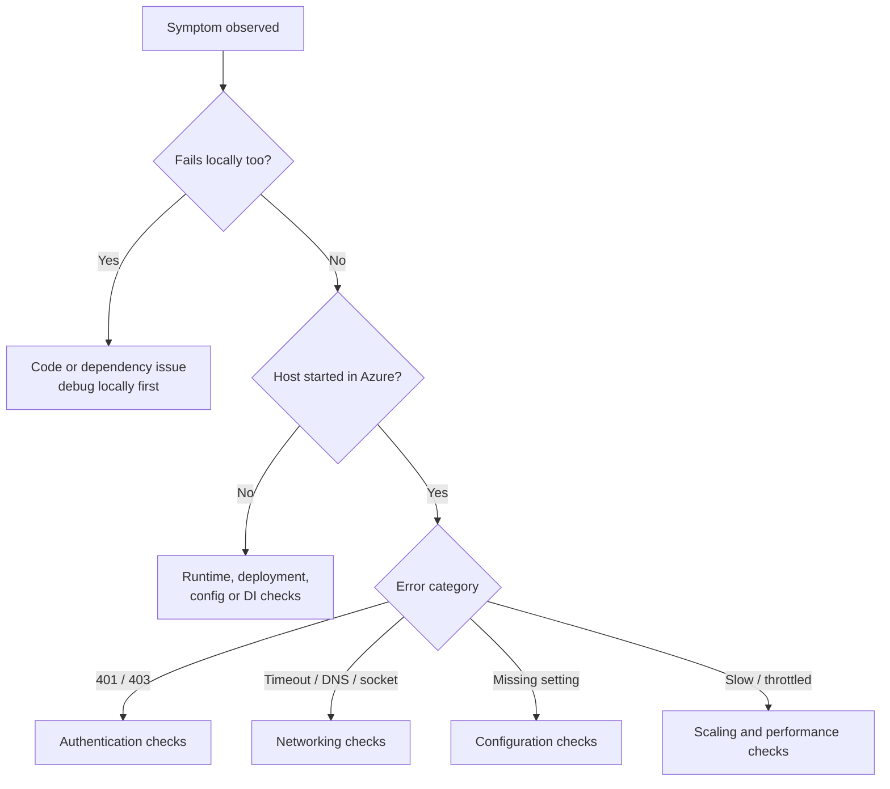

# Troubleshooting Checklist

> **Category:** Debugging and Troubleshooting · **Status:** Complete sample note · **Applies to:** Azure Functions isolated worker

Use this checklist when something is wrong and you do not yet know where. Work **top to bottom**: each section rules out a layer before moving on. Area-specific checklists go deeper.

> 💡 Write down what you checked and what you found. Most troubleshooting time is lost re-checking the same things.

---

## Quick triage (first 5 minutes)

1. **What changed?** Deployment, configuration, infrastructure, traffic, dependency version, certificate or secret expiry.
2. **Scope:** all functions or one? All instances or some? All requests or a percentage?
3. **Since when?** Correlate with deployment and change history.
4. **Where does it fail?** Locally, in Azure, or both?
5. **Error signature:** HTTP status, exception type and message, dependency result codes.



---

## What to check locally

- [ ] `func --version` matches the expected Core Tools major version for the runtime (verify against docs).
- [ ] `dotnet --list-sdks` contains the target framework SDK.
- [ ] `local.settings.json` exists and contains `FUNCTIONS_WORKER_RUNTIME = dotnet-isolated`.
- [ ] `AzureWebJobsStorage` points to Azurite (`UseDevelopmentStorage=true`) **and Azurite is running**, or to a real storage account.
- [ ] `az account show` shows the expected tenant and subscription (for `DefaultAzureCredential`).
- [ ] The project builds without warnings about mixed `Microsoft.Azure.WebJobs.*` and `Microsoft.Azure.Functions.Worker.*` packages.
- [ ] Functions are listed when `func start` runs. If not, check `[Function("Name")]` attributes and the build output.
- [ ] Breakpoints are hit (attach to the **worker process**, not only the host).

## What to check in Azure

- [ ] Functions appear in the portal function list.
- [ ] **Diagnose and solve problems** shows no critical detector findings.
- [ ] **Log stream** shows `Host started` and no repeating startup errors.
- [ ] The app is **running** (not stopped) and the plan has capacity.
- [ ] The latest deployment succeeded (Deployment Center / pipeline logs).
- [ ] Application Insights is connected (`APPLICATIONINSIGHTS_CONNECTION_STRING` set) and receiving data.

---

## Authentication checks

- [ ] Managed identity is **enabled** (system-assigned or user-assigned attached).
- [ ] For user-assigned identity, the **client ID** is configured (`AZURE_CLIENT_ID` for SDK clients; `<Prefix>__clientId` and `<Prefix>__credential = managedidentity` for trigger connections; verify setting names).
- [ ] The **correct principal** has the role (object/principal ID matches the Function App's identity).
- [ ] The role is a **data-plane** role (for example *Key Vault Secrets User*, *Azure Service Bus Data Receiver*, *Storage Blob Data Contributor*), not only *Contributor*.
- [ ] Role scope includes the target resource.
- [ ] Wait for propagation after new assignments, then **restart** the app.
- [ ] Key Vault permission model (RBAC vs access policies) matches how access was granted.
- [ ] For custom APIs: token **audience/scope** matches the API's app registration.
- [ ] HTTP-triggered functions: caller supplies a function key if `AuthorizationLevel.Function` is used; Easy Auth settings are as expected.

→ Details: [Authentication Issues](Authentication-Issues.md)

## Configuration checks

- [ ] Every key used in code exists in **App settings** (local values are not deployed).
- [ ] Nested keys use `__` (double underscore), not `:`.
- [ ] Key Vault references show a **resolved** status.
- [ ] `FUNCTIONS_WORKER_RUNTIME = dotnet-isolated`.
- [ ] `FUNCTIONS_EXTENSION_VERSION = ~4` (verify current recommendation).
- [ ] Options classes use `ValidateOnStart()` so missing values fail at startup with a clear message.
- [ ] Slot-specific ("deployment slot setting") values are correct after a swap.
- [ ] `host.json` is valid JSON and contains the expected extension settings.

→ Details: [Configuration Issues](Configuration-Issues.md)

## Networking checks

- [ ] Target resource **public network access** setting is known (enabled / disabled / selected networks).
- [ ] If private endpoints are used: the Function App has **VNet integration** and the plan supports it.
- [ ] **Private DNS** zones are linked to the integrated VNet; name resolution returns a **private IP**.
- [ ] Outbound traffic routing (for example "route all") is configured as intended.
- [ ] NSGs and firewalls allow the required outbound ports (443 for most Azure services; 5671/5672 for AMQP unless using WebSockets).
- [ ] `AzureWebJobsStorage` is reachable — if storage is network-restricted, additional configuration is required (verify current guidance).
- [ ] No SNAT port exhaustion (see Performance checks).

```bash
# From the Kudu / SSH console (where available)
nslookup <YOUR-RESOURCE-NAME>.vault.azure.net
curl -sv https://<YOUR-RESOURCE-NAME>.vault.azure.net/healthstatus
```

## Runtime checks

- [ ] .NET version configured on the app matches the project target framework.
- [ ] The worker process starts (no `Failed to start worker` / `worker process exited` messages).
- [ ] No unhandled exceptions in `Program.cs` during startup.
- [ ] Function timeout (`functionTimeout`) is appropriate for the hosting plan.
- [ ] The app is not repeatedly restarting (check restart events and memory).

## Dependency Injection checks

- [ ] Every constructor dependency of every function class is registered.
- [ ] No **scoped** service is injected into a **singleton** (captive dependency).
- [ ] Azure SDK clients and `HttpClient` are registered once (`AddAzureClients`, `AddHttpClient`), not created per invocation.
- [ ] Registrations are not inside environment-specific branches by mistake.
- [ ] Startup errors mentioning `Unable to resolve service for type` are investigated in the host logs.

→ Details: [Dependency Injection Issues](Dependency-Injection-Issues.md)

## Application Insights checks

- [ ] `APPLICATIONINSIGHTS_CONNECTION_STRING` is set.
- [ ] The worker is configured with `AddApplicationInsightsTelemetryWorkerService()` and `ConfigureFunctionsApplicationInsights()`.
- [ ] Log-level filters do not hide `Information` logs from your code (a default worker filter may only keep warnings — verify and adjust).
- [ ] Sampling is not dropping the telemetry you are looking for.

Useful queries:

```kusto
// Failed requests by function, last 1 hour
requests
| where timestamp > ago(1h) and success == false
| summarize failures = count() by operation_Name, resultCode
| order by failures desc
```

```kusto
// Top exceptions, last 24 hours
exceptions
| where timestamp > ago(24h)
| summarize count() by type, outerMessage
| top 20 by count_
```

```kusto
// Slow or failing dependencies
dependencies
| where timestamp > ago(1h)
| summarize calls = count(), failures = countif(success == false), p95 = percentile(duration, 95) by target, type
| order by failures desc
```

```kusto
// Trace one operation end to end
union requests, dependencies, traces, exceptions
| where operation_Id == "<OPERATION-ID>"
| order by timestamp asc
```

## Scaling checks

- [ ] Current instance count vs configured maximum (platform metrics / Live Metrics).
- [ ] Queue or event backlog trend (growing, stable or draining).
- [ ] Per-instance concurrency settings in `host.json` (for example Service Bus `maxConcurrentCalls`).
- [ ] Downstream dependencies are not overwhelmed by scale-out (429 / throttling).
- [ ] Cold start latency is acceptable for the hosting plan; consider always-ready / pre-warmed instances where supported.

→ Details: [Performance Issues](Performance-Issues.md)

## Deployment checks

- [ ] The deployed package contains the compiled worker and `functions.metadata` (or equivalent generated metadata).
- [ ] `WEBSITE_RUN_FROM_PACKAGE` (if used) points to a valid package and the identity can read it.
- [ ] The correct slot was deployed and swapped.
- [ ] No leftover files from a previous in-process deployment.
- [ ] Pipeline used the correct build configuration and target runtime.

→ Details: [Deployment Issues](Deployment-Issues.md)

---

## Common findings and fixes

| Finding | Fix |
| --- | --- |
| Setting exists locally only | Add to App settings / IaC; add `ValidateOnStart` |
| `:` in Linux setting names | Rename to `__` |
| 403 from Key Vault / Storage / Service Bus | Assign data-plane role to the managed identity; restart |
| `CredentialUnavailableException` in Azure | Enable managed identity; set client ID for user-assigned |
| DNS resolves to a public IP for a private-endpoint resource | Link private DNS zone to the VNet; check VNet integration |
| `Unable to resolve service for type` | Register the missing service in `Program.cs` |
| No `Information` logs in Application Insights | Adjust worker logging filter |
| HTTP 429 from downstream after scale-out | See [AP-001](../03-Architecture-Problems/AP-001-Downstream-API-Throttling.md) |
| Messages dead-lettered with lock lost | Increase lock duration / auto-renew; reduce processing time |

## Related notes

- [PS-001 Works Locally, Fails in Azure](../05-Production-Scenarios/PS-001-Works-Locally-Fails-in-Azure.md)
- [Local vs Azure Execution](../01-Basics/Local-vs-Azure-Execution.md)
- [CLI Commands](../08-Quick-Reference/CLI-Commands.md)

---

[Index](index.md) · [Next: Authentication Issues ➡️](Authentication-Issues.md)
