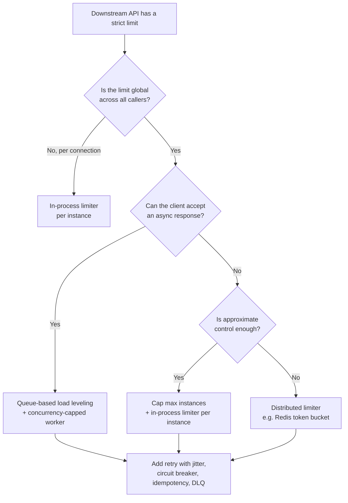

# Decision Matrix

> **Category:** Quick Reference · **Status:** Complete sample note

Decision tables for common Azure Function App architecture choices. Each table lists **conditions**, not rules. Always confirm the specific requirement, and verify plan/tier capabilities against current official documentation.

> 💡 How to read these tables: find the row whose **"Choose when…"** best matches your confirmed requirements, then check the **"Watch out for"** column before committing.

---

## 1. Synchronous vs asynchronous HTTP processing

| Option | Choose when… | Watch out for |
| --- | --- | --- |
| **Synchronous** (process and respond in one request) | Work is short (well under gateway timeouts), dependencies are fast and not rate-limited, client needs an immediate result | Timeouts during dependency slowness; scale-out multiplies downstream load |
| **Async request-reply** (202 + status URL) | Work is long, bursty, or calls rate-limited dependencies; requests must not be lost | Clients must poll or accept callbacks; status store required |
| **Fire-and-forget** (202, no status) | Client does not need the outcome (telemetry, audit events) | Failures invisible to client; need DLQ monitoring |

Related: [AP-001](../03-Architecture-Problems/AP-001-Downstream-API-Throttling.md), [AP-003](../03-Architecture-Problems/AP-003-Long-Running-Operation.md)

## 2. Messaging service

| Option | Choose when… | Watch out for |
| --- | --- | --- |
| **Service Bus queue** | Commands to one consumer; need DLQ, duplicate detection, sessions, scheduled delivery, peek-lock | Cost vs Storage queues; message size limits by tier |
| **Service Bus topic** | One event, several independent subscribers with filters | Subscription sprawl; each subscription needs DLQ monitoring |
| **Storage queue** | Simple, high-volume, low-cost work queue; no advanced features needed | No sessions or duplicate detection; smaller message size; poison queue instead of DLQ |
| **Event Hubs** | High-throughput event streams (telemetry, logs); replay from offset; partitioned ordering | Not a work queue — no per-message settlement; checkpointing semantics |
| **Event Grid** | Reactive notifications of state changes (blob created, resource events), push delivery | At-least-once delivery; retry schedule is service-controlled; not for large payloads |

## 3. Rate limiting placement

| Option | Choose when… | Watch out for |
| --- | --- | --- |
| **APIM inbound policy** (`rate-limit-by-key`) | Protect *your* API from clients; per-client fairness | Does not limit calls *your* function makes to others; counter accuracy depends on tier and gateway topology |
| **In-process limiter** (`System.Threading.RateLimiting`) | Protect a per-instance resource; single instance; limit is per connection | Enforces per instance only; global rate = limit × instances |
| **Concurrency cap** (max instances × concurrent calls) | Downstream limit is global and approximate control is enough | Controls in-flight calls, not calls/second; rate shifts with latency |
| **Distributed limiter** (Redis token bucket) | Precise global limit across many callers or apps | New dependency, latency and failure mode; must define fail-open vs fail-closed |
| **Queue-based load leveling** | Requests must not be rejected; bursts must be absorbed | Added latency; async contract required |

Related: [Rate Limiter vs Load Balancer](../02-Question-Answer/Rate-Limiter-vs-Load-Balancer.md)

## 4. Workflow coordination

| Option | Choose when… | Watch out for |
| --- | --- | --- |
| **Single function** | One step, short duration | Grows into a monolith if steps are added |
| **Queue chaining** (function → queue → function) | Few linear steps; independent scaling per step | Workflow state is implicit; correlation required |
| **Service Bus choreography** (events on a topic) | Steps owned by different teams; loose coupling | Hard to see the whole flow; compensation spread out |
| **Durable Functions orchestration** | Complex flows: fan-out/fan-in, timers, human interaction, explicit compensation | Deterministic orchestrator code; versioning; storage provider sizing |

## 5. Identity and secrets

| Option | Choose when… | Watch out for |
| --- | --- | --- |
| **System-assigned managed identity** | One app, lifecycle tied to app, simplest setup | Identity deleted with the app; role assignments must be recreated |
| **User-assigned managed identity** | Shared by several apps; pre-create roles before app deployment; identity outlives app | Must configure client ID in SDK and trigger settings |
| **Key Vault reference** | Third-party secret that cannot be replaced by identity | Identity needs secret read role; rotation strategy; reference resolution failures |
| **Connection string in app settings** | ❌ Avoid for Azure services that support Entra ID auth | Secret exposure to anyone with read access to settings |

Related: [DefaultAzureCredential: Local vs Azure](../02-Question-Answer/DefaultAzureCredential-Local-vs-Azure.md)

## 6. Caching

| Option | Choose when… | Watch out for |
| --- | --- | --- |
| **No cache** | Data changes constantly or reads are cheap | — |
| **In-memory per instance** (`IMemoryCache`) | Small, rarely changing reference data; staleness acceptable per instance | Each instance has its own copy; cold instances start empty |
| **Distributed cache** (Azure Cache for Redis) | Shared cache across instances; larger data; consistent invalidation | Network hop; cost; cache availability affects latency |
| **APIM response cache** | Cache whole GET responses at the gateway | Cache key design; per-user data must not be cached publicly |
| **CDN / Front Door cache** | Public, cacheable content at the edge | Invalidation delay; not for personalised data |

## 7. Retry strategy

| Error type | Retry? | Strategy |
| --- | --- | --- |
| 408, 429, 500, 502, 503, 504, network timeouts | ✅ Yes | Exponential backoff + jitter; honour `Retry-After`; cap attempts and total time |
| 400, 401, 403, 404, 409 (business conflict), 422 | ❌ No (usually) | Fail fast; dead-letter or return error; 401 may justify one retry after token refresh |
| Repeated failures to the same dependency | ⚠️ Stop | Circuit breaker; fail fast while open |
| Message processing exhaustion | ⚠️ Stop | Dead-letter queue + alert + replay runbook |

## 8. Hosting plan (summary)

| Requirement | Points towards… | Verify |
| --- | --- | --- |
| Lowest cost for spiky, low-volume work | Consumption or Flex Consumption | Cold start tolerance; execution limits |
| VNet integration / private endpoints | Flex Consumption, Elastic Premium, Dedicated, Container Apps | Current plan networking support |
| No cold start | Elastic Premium (pre-warmed), Flex Consumption (always-ready), Dedicated (always on) | Billing for idle capacity |
| Long executions | Elastic Premium, Dedicated, or redesign with Durable/queue | Plan timeout limits |
| Reuse existing App Service capacity | Dedicated | Manual or autoscale rules instead of event-driven scale |
| Container-based standardisation | Container Apps hosting | Feature parity with other plans |

Full comparison: [Hosting Plan Comparison](Hosting-Plan-Comparison.md)

---

## Decision flow: protecting a rate-limited downstream API

---

[⬅️ Previous: Trigger Selection Guide](Trigger-Selection-Guide.md) · [Index](index.md) · [Back to Azure Function App](../index.md)
