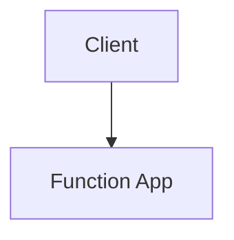

# Diagrams

Reusable Mermaid source files (`.mmd`) for Azure Function App notes.

| File | Description |
| --- | --- |
| [sample-function-flow.mmd](sample-function-flow.mmd) | HTTP-triggered function with queue-based processing, Managed Identity, Key Vault, retries and dead-lettering. |

## Why Mermaid?

- Diagrams are plain text, so changes are visible in Git diffs.
- MkDocs Material renders Mermaid fences natively.
- VS Code can preview them with a Mermaid extension.

## Using a diagram in a note

Mermaid does not support an "include" in plain Markdown. Copy the diagram body into a fenced block in the note:

````markdown

````

## Exporting to SVG or PNG (for PDF builds)

If the Mermaid CLI is installed (`npm install -g @mermaid-js/mermaid-cli`):

```bash
mmdc -i sample-function-flow.mmd -o sample-function-flow.svg
```

## Layout guidance

- Prefer `flowchart TB` (top to bottom) so diagrams fit an A4 page.
- Keep labels short; use `<br/>` for a second line.
- Group related nodes with `subgraph`.

---

[Back to Azure Function App](../../index.md)
