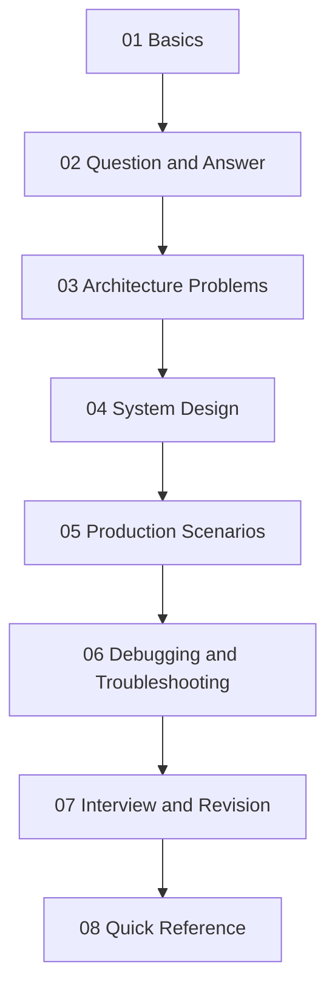

# Azure Function App

This section follows a **learning journey**: start with the basics, practise focused questions, then solve architecture problems and production scenarios that combine several concepts.

> **Status legend:** ✅ Complete sample note · 📝 Draft note

---

## Basics

Foundational concepts you need before solving problems. → [Basics index](01-Basics/index.md)

| Note | Status |
| --- | --- |
| [Azure Functions Overview](01-Basics/Azure-Functions-Overview.md) | ✅ |
| [Hosting Plans](01-Basics/Hosting-Plans.md) | 📝 |
| [Triggers and Bindings](01-Basics/Triggers-and-Bindings.md) | 📝 |
| [In-Process vs Isolated Worker](01-Basics/In-Process-vs-Isolated-Worker.md) | 📝 |
| [Project Structure](01-Basics/Project-Structure.md) | 📝 |
| [Configuration and Environment](01-Basics/Configuration-and-Environment.md) | 📝 |
| [Local vs Azure Execution](01-Basics/Local-vs-Azure-Execution.md) | 📝 |

## Question and Answer

One practical question per note. → [Question and Answer index](02-Question-Answer/index.md)

| Question | Status |
| --- | --- |
| [How do I use Dependency Injection in the isolated worker?](02-Question-Answer/Dependency-Injection-in-Isolated-Worker.md) | 📝 |
| [When do I need CORS, and when does API Management replace it?](02-Question-Answer/CORS-vs-API-Management.md) | 📝 |
| [What is the difference between a rate limiter and a load balancer?](02-Question-Answer/Rate-Limiter-vs-Load-Balancer.md) | ✅ |
| [How does DefaultAzureCredential behave locally vs in Azure?](02-Question-Answer/DefaultAzureCredential-Local-vs-Azure.md) | ✅ |
| [How should connections be managed with Managed Identity?](02-Question-Answer/Managed-Identity-Connection-Management.md) | 📝 |
| [How do Azure Functions scale?](02-Question-Answer/Function-Scaling-Questions.md) | 📝 |

## Architecture Problems

Constraint-driven problems that combine several concepts. → [Architecture Problems index](03-Architecture-Problems/index.md)

| ID | Problem | Difficulty | Status |
| --- | --- | --- | --- |
| AP-001 | [Downstream API Throttling](03-Architecture-Problems/AP-001-Downstream-API-Throttling.md) | Advanced | ✅ |
| AP-002 | [Duplicate Message Processing](03-Architecture-Problems/AP-002-Duplicate-Message-Processing.md) | Intermediate | 📝 |
| AP-003 | [Long-Running Operation](03-Architecture-Problems/AP-003-Long-Running-Operation.md) | Intermediate | 📝 |
| AP-004 | [High-Traffic HTTP Function](03-Architecture-Problems/AP-004-High-Traffic-HTTP-Function.md) | Advanced | 📝 |
| AP-005 | [Secure Secretless Architecture](03-Architecture-Problems/AP-005-Secure-Secretless-Architecture.md) | Intermediate | 📝 |

## System Design

Complete solutions where Azure Function App is a key component. → [System Design index](04-System-Design/index.md)

| ID | Design | Status |
| --- | --- | --- |
| SD-001 | [Order Processing System](04-System-Design/SD-001-Order-Processing-System.md) | ✅ |
| SD-002 | [Payment Processing System](04-System-Design/SD-002-Payment-Processing-System.md) | 📝 |
| SD-003 | [Notification System](04-System-Design/SD-003-Notification-System.md) | 📝 |
| SD-004 | [File Processing Pipeline](04-System-Design/SD-004-File-Processing-Pipeline.md) | 📝 |
| SD-005 | [High-Volume Event Processing](04-System-Design/SD-005-High-Volume-Event-Processing.md) | 📝 |

## Production Scenarios

Start from a real symptom and work to a permanent fix. → [Production Scenarios index](05-Production-Scenarios/index.md)

| ID | Symptom | Status |
| --- | --- | --- |
| PS-001 | [It works locally but fails in Azure](05-Production-Scenarios/PS-001-Works-Locally-Fails-in-Azure.md) | ✅ |
| PS-002 | [Requests intermittently time out](05-Production-Scenarios/PS-002-Intermittent-Timeouts.md) | 📝 |
| PS-003 | [Sudden traffic spike](05-Production-Scenarios/PS-003-Sudden-Traffic-Spike.md) | 📝 |
| PS-004 | [Service Bus messages keep failing](05-Production-Scenarios/PS-004-Service-Bus-Message-Failures.md) | 📝 |
| PS-005 | [Authentication fails](05-Production-Scenarios/PS-005-Authentication-Failure.md) | 📝 |

## Debugging and Troubleshooting

Checklists for structured investigation. → [Debugging index](06-Debugging-Troubleshooting/index.md)

| Checklist | Status |
| --- | --- |
| [Troubleshooting Checklist](06-Debugging-Troubleshooting/Troubleshooting-Checklist.md) | ✅ |
| [Authentication Issues](06-Debugging-Troubleshooting/Authentication-Issues.md) | 📝 |
| [Dependency Injection Issues](06-Debugging-Troubleshooting/Dependency-Injection-Issues.md) | 📝 |
| [Configuration Issues](06-Debugging-Troubleshooting/Configuration-Issues.md) | 📝 |
| [Performance Issues](06-Debugging-Troubleshooting/Performance-Issues.md) | 📝 |
| [Deployment Issues](06-Debugging-Troubleshooting/Deployment-Issues.md) | 📝 |

## Interview and Revision

Graded questions with one-line revision answers. → [Interview and Revision index](07-Interview-Revision/index.md)

| Set | Level | Status |
| --- | --- | --- |
| [Basic Questions](07-Interview-Revision/Basic-Questions.md) | Basic | 📝 |
| [Intermediate Questions](07-Interview-Revision/Intermediate-Questions.md) | Intermediate | 📝 |
| [Advanced Architecture Questions](07-Interview-Revision/Advanced-Architecture-Questions.md) | Advanced / Scenario | ✅ |
| [Rapid Revision](07-Interview-Revision/Rapid-Revision.md) | All | 📝 |

## Quick Reference

Commands, cheat sheets and decision tables. → [Quick Reference index](08-Quick-Reference/index.md)

| Reference | Status |
| --- | --- |
| [CLI Commands](08-Quick-Reference/CLI-Commands.md) | 📝 |
| [Configuration Cheatsheet](08-Quick-Reference/Configuration-Cheatsheet.md) | 📝 |
| [Hosting Plan Comparison](08-Quick-Reference/Hosting-Plan-Comparison.md) | 📝 |
| [Trigger Selection Guide](08-Quick-Reference/Trigger-Selection-Guide.md) | 📝 |
| [Decision Matrix](08-Quick-Reference/Decision-Matrix.md) | ✅ |

## Assets

- [Images](assets/images/README.md)
- [Diagrams](assets/diagrams/README.md)

---

[Back to Azure](../index.md) · [Home](../../index.md)
