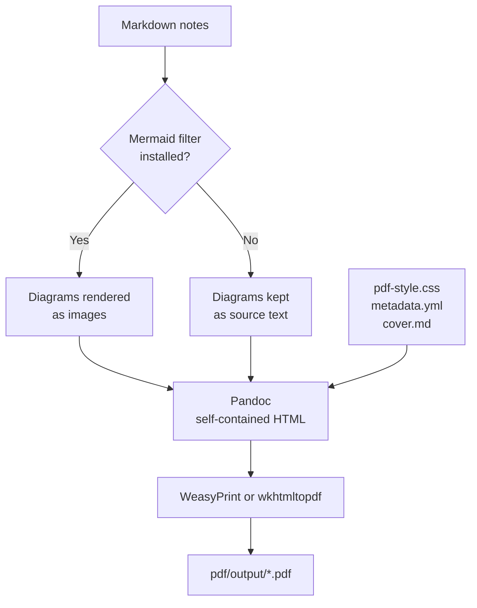

# PDF Generation

The Markdown files in `docs/` are the **source of truth**. This folder contains what is needed to convert selected notes into a professional A4 PDF.



## Contents of this folder

| File | Purpose |
| --- | --- |
| `metadata.yml` | Pandoc metadata (HTML title, author, language, table-of-contents title). Replace the author placeholder. |
| `pdf-style.css` | A4 page size, margins, typography, dark code blocks, tables, page-break rules. |
| `cover.md` | Cover page content. |
| `output/` | Generated PDFs. Contents are git-ignored except `.gitkeep`. |

## Prerequisites

Install these manually. The scripts check for them and fail with a clear message if they are missing.

| Tool | Required | Purpose | Install hint |
| --- | --- | --- | --- |
| **Pandoc 3.x** | Yes | Markdown → HTML | <https://pandoc.org/installing.html> (Windows: `winget install JohnMacFarlane.Pandoc`) |
| **WeasyPrint** | One engine is required | HTML → PDF with good CSS paged-media support (recommended) | `pip install weasyprint` — on Windows it also needs the GTK/Pango runtime; follow the WeasyPrint installation guide |
| **wkhtmltopdf** | Alternative engine | HTML → PDF | <https://wkhtmltopdf.org/downloads.html> (project is archived; works but has weaker CSS support) |
| **mermaid-filter** | Optional | Render Mermaid blocks to images | `npm install -g mermaid-filter` (needs Node.js; it uses a headless browser) |

> ⚠️ Tool versions and install steps change. Verify against each tool's current documentation.

## Build a PDF

```powershell
# Everything under docs/Azure/Azure-Function-App
.\scripts\build-pdf.ps1

# Custom name
.\scripts\build-pdf.ps1 -OutputName "azure-function-app.pdf"
```

```bash
./scripts/build-pdf.sh
./scripts/build-pdf.sh -o azure-function-app.pdf
```

The PDF is written to `pdf/output/`. See [scripts/README.md](../scripts/README.md) for all options.

## Choosing source Markdown files

Pass file paths **relative to the repository root**, in the order they should appear in the PDF:

```powershell
.\scripts\build-pdf.ps1 -OutputName "throttling.pdf" -Files `
  "docs/Azure/Azure-Function-App/02-Question-Answer/Rate-Limiter-vs-Load-Balancer.md", `
  "docs/Azure/Azure-Function-App/03-Architecture-Problems/AP-001-Downstream-API-Throttling.md"
```

```bash
./scripts/build-pdf.sh -o throttling.pdf \
  docs/Azure/Azure-Function-App/02-Question-Answer/Rate-Limiter-vs-Load-Balancer.md \
  docs/Azure/Azure-Function-App/03-Architecture-Problems/AP-001-Downstream-API-Throttling.md
```

Without file arguments, the scripts include every note under `docs/Azure/Azure-Function-App` (excluding the `assets` folder), ordered by folder with `index.md` first.

## Preserving relative images

- Reference images with **relative paths** in the notes, for example ``.
- The scripts pass every selected file's folder (and `docs/`) to Pandoc as `--resource-path`, so relative images resolve from the note that references them.
- `--embed-resources` inlines images into the HTML so the PDF engine does not need file access to them.
- Do not use absolute paths such as `C:\Users\...`; they break on other machines.

## Code highlighting

- Pandoc highlights fenced code blocks that have a language tag (`csharp`, `json`, `bash`, `powershell`, `xml`, `kusto`, and others).
- The script uses the `breezedark` Pandoc style and `pdf-style.css` overrides token colours to match a dark IDE-like palette.
- Always tag code fences. An untagged fence renders without highlighting.
- Run `pandoc --list-highlight-languages` to see supported languages. A language unknown to Pandoc (for example `kusto` in some versions) renders as plain text inside the dark block — this is cosmetic.

## Mermaid diagrams

Pandoc does not render Mermaid by itself. Choose one approach **before** generating the PDF:

1. **Mermaid filter (automatic).** Install `mermaid-filter`. The scripts detect it and render each ` ```mermaid ` block to an image during conversion. Requires Node.js and a headless Chromium (installed with Puppeteer).
2. **Pre-render with Mermaid CLI (manual).** Export a diagram to SVG and reference it as an image in a copy of the note:

    ```bash
    npm install -g @mermaid-js/mermaid-cli
    mmdc -i docs/Azure/Azure-Function-App/assets/diagrams/sample-function-flow.mmd \
         -o docs/Azure/Azure-Function-App/assets/images/sample-function-flow.svg
    ```

3. **Accept source text.** With neither tool installed, diagrams appear as code blocks. The build still succeeds, and the script prints a warning.

> 💡 Keep diagrams narrow (top-to-bottom layouts) so they fit an A4 page after rendering.

## Page-break control

`pdf-style.css` already applies these rules:

- each top-level heading (`h1`) starts a new page;
- headings stay with the paragraph that follows (`break-after: avoid`);
- code blocks, tables, blockquotes and figures avoid splitting across pages;
- table header rows repeat on page breaks;
- the "Previous · Index · Next" navigation line is hidden in the PDF.

For manual control, insert a raw HTML helper in a note:

```html
<div class="page-break"></div>
<div class="keep-together">…content that must stay on one page…</div>
```

For a very long code block that cannot fit on one page, add the class `long` to its container through Pandoc attributes, for example ` ```{.csharp .long} `.

## Output location

All generated files go to **`pdf/output/`** only. The scripts never modify or delete Markdown sources. The intermediate HTML file is removed after a successful build unless you pass `-KeepHtml` / `--keep-html`.

## Troubleshooting

### Missing images

| Symptom | Likely cause | Fix |
| --- | --- | --- |
| Pandoc warning: `Could not fetch resource` | Wrong relative path, or file not present | Check the path from the note's folder; verify the file exists |
| Image shows as broken in the PDF | Image referenced from a note that was not passed through `--resource-path` | Use the provided scripts (they set it); keep images under `docs/` |
| Image appears in the site but not the PDF | Site-only path style (for example root-relative `/assets/...`) | Use relative paths such as `../assets/images/x.png` |
| SVG image missing in wkhtmltopdf | Engine SVG limitations | Use PNG, or switch to WeasyPrint |

Run the build with `-KeepHtml` and open the HTML in a browser to see which images fail.

### Missing fonts

- The stylesheet uses system-safe stacks: Segoe UI / Helvetica Neue / Liberation Sans / Arial for text; Cascadia Code / Consolas / DejaVu Sans Mono / Liberation Mono for code. No online fonts are used.
- If the PDF shows unexpected fonts or missing glyphs (for example emoji icons rendered as boxes):
  - Install a font containing the glyphs (for example *Noto Color Emoji* or *Segoe UI Emoji* where available).
  - On Linux, run `fc-list | grep -i "<font name>"` and `fc-cache -f` after installing fonts.
  - WeasyPrint uses system fonts through Fontconfig/Pango; wkhtmltopdf uses system fonts through Qt.
- Emoji support differs by engine. If emoji do not render, the notes remain readable because each icon accompanies text.

### Other problems

| Symptom | Fix |
| --- | --- |
| `Pandoc was not found` | Install Pandoc and reopen the terminal so `PATH` refreshes |
| `No PDF engine found` | Install WeasyPrint or wkhtmltopdf |
| WeasyPrint fails to start on Windows | Install the GTK/Pango runtime as described in WeasyPrint's documentation |
| Tables overflow the page | Reduce columns in the note, or shorten cell text |
| Code lines are cut off | The stylesheet wraps long lines; check that `pre` rules were not overridden |
| PowerShell: "running scripts is disabled" | Use `powershell -NoProfile -ExecutionPolicy Bypass -File scripts\build-pdf.ps1` |
| MkDocs-only syntax appears literally (`!!! note`, `=== "tab"`) | Pandoc does not understand Material extensions. Use blockquotes in notes intended for PDF |

## Alternative: print from the website

You can also open the MkDocs site and use the browser's **Print → Save as PDF**. `docs/assets/stylesheets/print.css` provides A4 print rules for that route. The Pandoc route gives more control over the cover, table of contents and file selection.

---

[Back to repository README](../README.md) · [Scripts documentation](../scripts/README.md)
