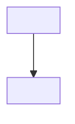
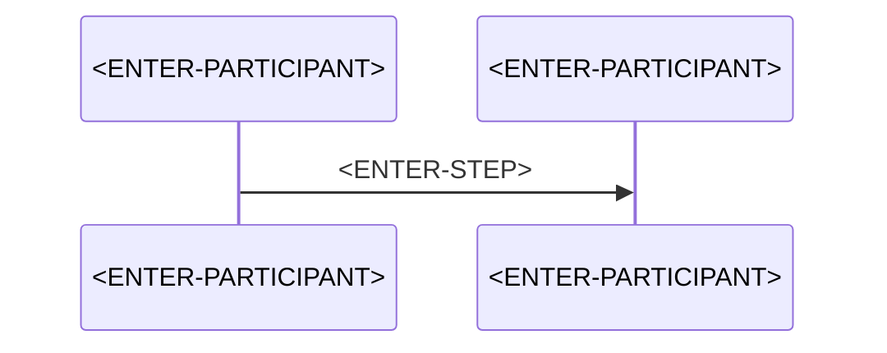

# AP-<ENTER-NUMBER>: <ENTER-TITLE>

> **Category:** Architecture Problem · **Difficulty:** <ENTER-DIFFICULTY: Beginner / Intermediate / Advanced> · **Status:** Draft note · **Last reviewed:** <ENTER-DATE>

<!-- Architecture problems must be realistic and constraint-driven. -->
<!-- Combine several concepts only where they are genuinely relevant. Do not force every pattern into every problem. -->
<!-- Clearly separate FACTS (given), ASSUMPTIONS (yours), ALTERNATIVES and RECOMMENDATIONS. -->

## 1. Problem title

<ENTER-TITLE>

## 2. Difficulty level

<!-- Beginner / Intermediate / Advanced. Add one sentence explaining why. -->

<ENTER-DIFFICULTY>

## 3. Problem statement

<!-- Describe the business situation in 3–6 sentences. What is going wrong and for whom? -->

<ENTER-PROBLEM>

## 4. Existing architecture

<!-- Describe the CURRENT system before any changes. A small diagram helps. -->



## 5. Symptoms

<!-- Observable facts only: error codes, metrics, user complaints. No guesses yet. -->

- <ENTER-SYMPTOM>

## 6. Functional requirements

- FR-1: <ENTER-REQUIREMENT>
- FR-2: <ENTER-REQUIREMENT>

## 7. Non-functional requirements

<!-- Latency, throughput, availability, durability, security, cost. Quantify where possible. -->

| ID | Requirement | Target |
| --- | --- | --- |
| NFR-1 | <ENTER-REQUIREMENT> | <ENTER-TARGET> |

## 8. Constraints

<!-- List only confirmed constraints. Things you cannot change (e.g. "downstream API cannot be modified"). -->

- C-1: <ENTER-CONSTRAINT>
- C-2: <ENTER-CONSTRAINT>

## 9. Assumptions

<!-- Things you believe but have not confirmed. Each assumption should be testable. -->

- A-1: <ENTER-ASSUMPTION>

## 10. Questions to consider

<!-- Questions you would ask stakeholders before designing. -->

1. <ENTER-QUESTION>

## 11. Root-cause analysis

<!-- Connect each symptom to a cause. Use a table if there are several. -->

| Symptom | Underlying cause | Evidence |
| --- | --- | --- |
| <ENTER-SYMPTOM> | <ENTER-CAUSE> | <ENTER-EVIDENCE> |

## 12. Recommended architecture

<!-- State the recommendation and the assumptions it depends on. -->

<ENTER-SOLUTION>

## 13. Architecture diagram

<!-- Prefer top-to-bottom flowcharts so the diagram fits an A4 page. Show identity, monitoring, and error/retry paths. -->


## 14. Component responsibilities

<!-- Explain why each component is required. If you cannot explain why, remove it. -->

| Component | Responsibility | Why it is required |
| --- | --- | --- |
| <ENTER-COMPONENT> | <ENTER-RESPONSIBILITY> | <ENTER-JUSTIFICATION> |

## 15. End-to-end request or event flow



## 16. C# implementation approach

<!-- .NET isolated worker. Label as Simplified / Conceptual / Production-oriented. Never claim conceptual code is production-complete. -->

**<ENTER-EXAMPLE-LABEL>**

```csharp
// <ENTER-CODE>
```

## 17. Configuration examples

<!-- Use placeholders only: <YOUR-KEY-VAULT-URL>, <YOUR-SERVICE-BUS-NAMESPACE>, <YOUR-APPLICATION-SETTING>, <YOUR-API-ENDPOINT>. -->

```json
{
  "<ENTER-SETTING>": "<YOUR-APPLICATION-SETTING>"
}
```

## 18. Security considerations

<!-- Identity, least privilege, network isolation, secret handling, data protection. -->

- <ENTER-SECURITY-CONSIDERATION>

## 19. Scalability considerations

<!-- What happens at 10x load? Which component saturates first? -->

- <ENTER-SCALABILITY-CONSIDERATION>

## 20. Reliability considerations

- <ENTER-RELIABILITY-CONSIDERATION>

## 21. Observability and monitoring

<!-- Which logs, metrics, traces and alerts prove the system is healthy? -->

| Signal | Source | Alert condition |
| --- | --- | --- |
| <ENTER-SIGNAL> | <ENTER-SOURCE> | <ENTER-CONDITION> |

## 22. Failure scenarios

| Failure | Impact | Detection | Handling |
| --- | --- | --- | --- |
| <ENTER-FAILURE> | <ENTER-IMPACT> | <ENTER-DETECTION> | <ENTER-HANDLING> |

## 23. Retry and recovery strategy

<!-- Which errors are retried, how often, with what backoff, and where do permanent failures go? -->

<ENTER-RETRY-STRATEGY>

## 24. Trade-offs

| Decision | Benefit | Cost |
| --- | --- | --- |
| <ENTER-DECISION> | <ENTER-BENEFIT> | <ENTER-COST> |

## 25. Alternative solutions

| Alternative | When it fits | Why not chosen here |
| --- | --- | --- |
| <ENTER-ALTERNATIVE> | <ENTER-FIT> | <ENTER-REASON> |

## 26. Why the recommended solution is preferred

<!-- Tie the choice back to the constraints and NFRs. Avoid universal claims. -->

<ENTER-JUSTIFICATION>

## 27. Production-readiness checklist

- [ ] <ENTER-CHECK>

## 28. Follow-up questions

1. <ENTER-FOLLOW-UP-QUESTION>

## 29. Quick revision summary

📌 <ENTER-SUMMARY>

---

[⬅️ Previous](<ENTER-PREVIOUS-NOTE>) · [Index](index.md) · [Next ➡️](<ENTER-NEXT-NOTE>)
