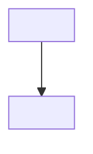

# <ENTER-TITLE>

> **Category:** Basics · **Status:** Draft note · **Last reviewed:** <ENTER-DATE>

<!-- Keep basic notes focused and practical. Aim for 5–10 minutes of reading. -->
<!-- Define every new term before using it deeply. -->

## What it is

<!-- One or two sentences. A learner should be able to repeat this definition. -->

<ENTER-DEFINITION>

## Why it is used

<!-- Describe the problem this concept solves. Explain WHY, not only WHAT. -->

- <ENTER-REASON>
- <ENTER-REASON>

## How it works

<!-- Numbered steps work best. Add a small Mermaid diagram if it clarifies the flow. -->

1. <ENTER-STEP>
2. <ENTER-STEP>
3. <ENTER-STEP>



## Important components

| Component | Responsibility |
| --- | --- |
| <ENTER-COMPONENT> | <ENTER-RESPONSIBILITY> |

## Simple example

<!-- Label the code: Simplified example / Conceptual example / Production-oriented example. -->
<!-- Azure Functions C# examples must use the .NET isolated worker model. -->

**Simplified example**

```csharp
// <ENTER-CODE>
```

## Common mistakes

- ❌ <ENTER-MISTAKE>
- ❌ <ENTER-MISTAKE>

## Quick summary

📌 <ENTER-SUMMARY>

## Related notes

<!-- Use relative links only. Never use absolute local machine paths. -->

- [<ENTER-RELATED-NOTE>](<ENTER-RELATIVE-PATH>)

---

[⬅️ Previous](<ENTER-PREVIOUS-NOTE>) · [Index](index.md) · [Next ➡️](<ENTER-NEXT-NOTE>)
