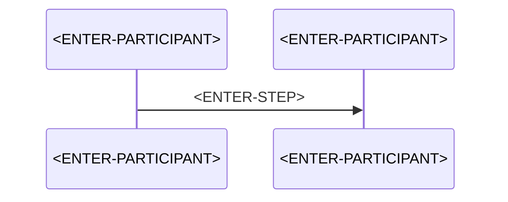

# <ENTER-QUESTION-AS-TITLE>

> **Category:** Question and Answer · **Status:** Draft note · **Last reviewed:** <ENTER-DATE>

<!-- The filename and this H1 should make the question obvious, e.g. "How does X behave locally vs in Azure?" -->

## 1. Question

<!-- Write the exact question as you would ask it in a design review. -->

<ENTER-QUESTION>

## 2. Short answer

<!-- Two to four sentences. This is the answer you would give if you had 30 seconds. -->

<ENTER-SHORT-ANSWER>

## 3. Detailed explanation

<!-- Define terms first. Separate facts from opinions. -->

<ENTER-DETAILED-EXPLANATION>

## 4. How it works

<!-- Steps or a Mermaid sequence diagram. -->



## 5. Local development behavior

<!-- What happens on the developer machine (Azure Functions Core Tools, local.settings.json, emulators, developer credentials). -->

<ENTER-LOCAL-BEHAVIOR>

## 6. Azure production behavior

<!-- What happens in Azure. Mention hosting-plan or runtime-version dependencies explicitly. -->

<ENTER-AZURE-BEHAVIOR>

> ⚠️ Verify against current official documentation if the behaviour is version-sensitive.

## 7. C# isolated-worker example

<!-- Label the code: Simplified example / Conceptual example / Production-oriented example. -->

**<ENTER-EXAMPLE-LABEL>**

```csharp
// <ENTER-CODE>
```

## 8. Common misunderstanding

- ❌ <ENTER-MISUNDERSTANDING>
- ✅ <ENTER-CORRECTION>

## 9. Recommended approach

<!-- State the recommendation and the assumptions it depends on. -->

✅ <ENTER-SOLUTION>

## 10. When not to use it

- <ENTER-EXCEPTION>

## 11. Related questions

- [<ENTER-RELATED-QUESTION>](<ENTER-RELATIVE-PATH>)

## 12. Quick revision answer

📌 <ENTER-ONE-LINE-ANSWER>

---

[⬅️ Previous](<ENTER-PREVIOUS-NOTE>) · [Index](index.md) · [Next ➡️](<ENTER-NEXT-NOTE>)
