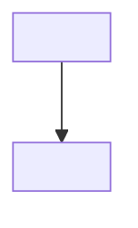
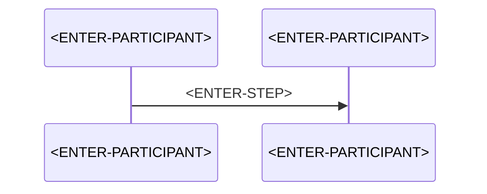

# SD-<ENTER-NUMBER>: <ENTER-TITLE>

> **Category:** System Design · **Status:** Draft note · **Last reviewed:** <ENTER-DATE>

<!-- A system design note describes a COMPLETE solution in which Azure Function App is an important component. -->
<!-- Keep facts, assumptions, alternatives and recommendations clearly separated. -->

## 1. Design question

<!-- Phrase it as an interviewer would: "Design a ... that ..." -->

<ENTER-PROBLEM>

## 2. Business context

<!-- Who uses the system, why it matters, and what success looks like. -->

<ENTER-BUSINESS-CONTEXT>

## 3. Scope

- <ENTER-IN-SCOPE-ITEM>

## 4. Out-of-scope items

<!-- Explicitly excluding items keeps the design focused. -->

- <ENTER-OUT-OF-SCOPE-ITEM>

## 5. Functional requirements

- FR-1: <ENTER-REQUIREMENT>

## 6. Non-functional requirements

| ID | Requirement | Target |
| --- | --- | --- |
| NFR-1 | <ENTER-REQUIREMENT> | <ENTER-TARGET> |

## 7. Expected traffic and workload assumptions

<!-- Peak vs average, payload size, read/write ratio, growth. Label every number as an assumption. -->

| Metric | Assumed value |
| --- | --- |
| <ENTER-METRIC> | <ENTER-VALUE> |

## 8. Major design challenges

1. <ENTER-CHALLENGE>

## 9. High-level architecture

<ENTER-SOLUTION>

## 10. Architecture diagram

<!-- Top-to-bottom layout. Show clients, entry point, Function App, messaging, storage, Key Vault, Managed Identity, monitoring, downstream services and error paths. -->

## 11. Component selection

<!-- Explain why this component is required and what was considered instead. -->

| Need | Selected component | Considered alternatives |
| --- | --- | --- |
| <ENTER-NEED> | <ENTER-COMPONENT> | <ENTER-ALTERNATIVES> |

## 12. Component responsibility

| Component | Responsibility |
| --- | --- |
| <ENTER-COMPONENT> | <ENTER-RESPONSIBILITY> |

## 13. Data flow

1. <ENTER-STEP>

## 14. API or event flow

## 15. Data storage strategy

<!-- Which store for which data, partitioning, consistency, retention. -->

<ENTER-STORAGE-STRATEGY>

## 16. Security design

<ENTER-SECURITY-DESIGN>

## 17. Identity and access

| Caller | Target | Identity | Role / permission |
| --- | --- | --- | --- |
| <ENTER-CALLER> | <ENTER-TARGET> | <ENTER-IDENTITY> | <ENTER-ROLE> |

## 18. Scaling strategy

<!-- Mention hosting-plan dependencies explicitly. -->

<ENTER-SCALING-STRATEGY>

## 19. Resilience strategy

<ENTER-RESILIENCE-STRATEGY>

## 20. Idempotency strategy

<!-- What is the idempotency key? Where is it stored? How long is it kept? -->

<ENTER-IDEMPOTENCY-STRATEGY>

## 21. Retry and dead-letter handling

<ENTER-RETRY-AND-DLQ-STRATEGY>

## 22. Monitoring and observability

| Signal | Source | Alert condition |
| --- | --- | --- |
| <ENTER-SIGNAL> | <ENTER-SOURCE> | <ENTER-CONDITION> |

## 23. Deployment approach

<!-- IaC, slots, pipelines, configuration promotion. -->

<ENTER-DEPLOYMENT-APPROACH>

## 24. Disaster recovery considerations

<!-- RPO, RTO, region strategy. -->

<ENTER-DR-CONSIDERATIONS>

## 25. Cost considerations

<ENTER-COST-CONSIDERATIONS>

## 26. Technical trade-offs

| Decision | Benefit | Cost |
| --- | --- | --- |
| <ENTER-DECISION> | <ENTER-BENEFIT> | <ENTER-COST> |

## 27. Alternative architecture

<ENTER-ALTERNATIVE-ARCHITECTURE>

## 28. Failure-mode analysis

| Component failure | Impact | Detection | Mitigation |
| --- | --- | --- | --- |
| <ENTER-FAILURE> | <ENTER-IMPACT> | <ENTER-DETECTION> | <ENTER-MITIGATION> |

## 29. Production-readiness checklist

- [ ] <ENTER-CHECK>

## 30. Interview-style follow-up questions

1. <ENTER-FOLLOW-UP-QUESTION>

---

[⬅️ Previous](<ENTER-PREVIOUS-NOTE>) · [Index](index.md) · [Next ➡️](<ENTER-NEXT-NOTE>)
